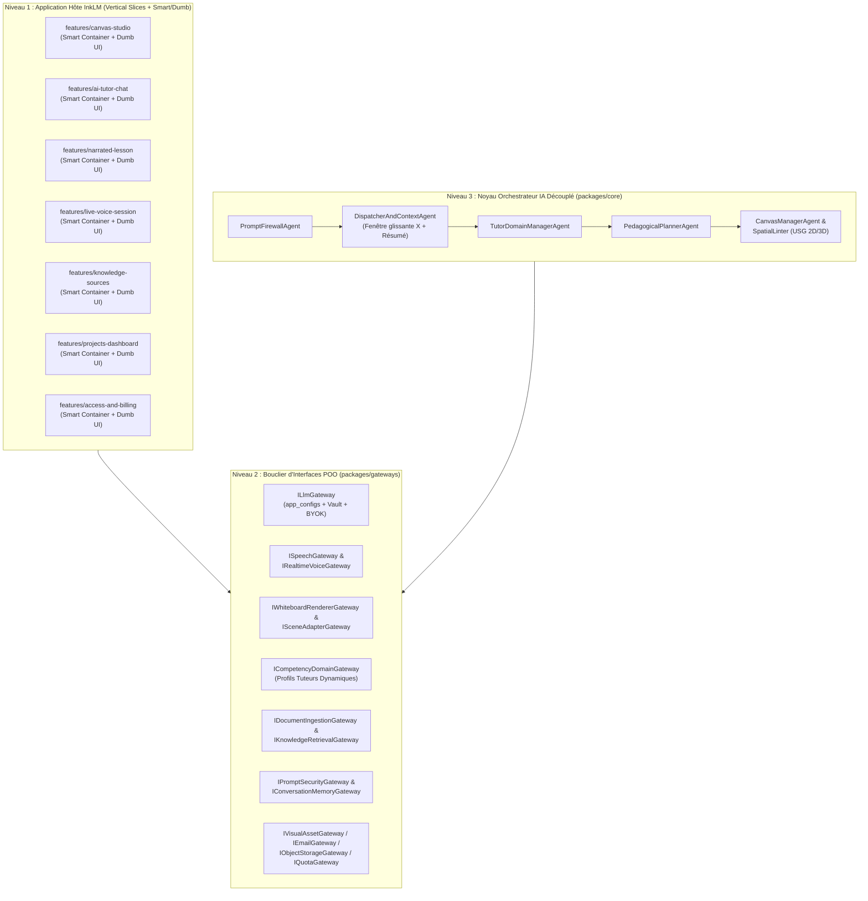

# Rapport d'Architecture Cible : Approche « Vertical Slicing + Smart/Dumb + Gateways » & Prompts d'Exécution (Phases 2, 3 et 4)

**Projet** : **InkLM / Whiteboard AI Orchestrator**  
**Date** : 12 Novembre 2026  
**Références** :
- Spécifications fonctionnelles : [`_dev/spec/00_index_specs.md`](file:///c:/dev/_current_apps/whiteboard-ai-orchestrator/_dev/spec/00_index_specs.md) (`01` à `06`)
- Plans d'architecture : [`_dev/implementation_plans/00_index_architecture.md`](file:///c:/dev/_current_apps/whiteboard-ai-orchestrator/_dev/implementation_plans/00_index_architecture.md) (`01` à `06`)
- Notes d'architecture & feuille de route : [`_dev/_notes_architecture_actuelle.md`](file:///c:/dev/_current_apps/whiteboard-ai-orchestrator/_dev/_notes_architecture_actuelle.md) & [`_dev/__toDo_mohamed.md`](file:///c:/dev/_current_apps/whiteboard-ai-orchestrator/_dev/__toDo_mohamed.md)
- Audit de sécurité et performance : [`_bemba/inklm_audit_perf_sec/01_executive_summary.md`](file:///c:/dev/_current_apps/whiteboard-ai-orchestrator/_bemba/inklm_audit_perf_sec/01_executive_summary.md)

---

## Partie 1 — Analyse de l'Adéquation Architecturale au Projet `inklm`

### 1.1 Pourquoi le Trio « Gateways + Smart/Dumb + Vertical Slicing » est la Clé du Découplage

L'inspection du code source d'`inklm` confirme que les difficultés actuelles de maintenance et d'extension proviennent de **trois formes de couplage fort** que ce trio architectural résout méthodiquement :

1. **Les *Gateways* (Ports & Adaptateurs / Interfaces POO) isolent l'infrastructure et les librairies tierces** :
   - Dans l'état actuel, l'orchestrateur ([`packages/core/src/agent/orchestrator.ts`](file:///c:/dev/_current_apps/whiteboard-ai-orchestrator/inklm/packages/core/src/agent/orchestrator.ts)) et le Worker ([`apps/functions/src/index.ts`](file:///c:/dev/_current_apps/whiteboard-ai-orchestrator/inklm/apps/functions/src/index.ts)) appellent directement les SDKs `@ai-sdk/google`, `@ai-sdk/openai`, `@google/genai`, les URLs `openrouter.ai`, `api.meta.ai`, `api.resend.com`, `commons.wikimedia.org`, ainsi que les tables Supabase et le bucket Cloudflare R2.
   - En appliquant le principe d'**Encapsulation et d'Inversion de Dépendance (SOLID)** via des interfaces TypeScript strictes (`ILlmGateway`, `ISpeechGateway`, `IWhiteboardRendererGateway`, etc.), le code applicatif et l'orchestrateur ne manipulent plus que des **contrats abstraits**. Remplacer Resend par AWS SES, Gemini TTS par ElevenLabs, ou Excalidraw par un moteur 2D/3D custom se fait en créant une nouvelle classe implémentant l'interface, **sans toucher une seule ligne de la logique métier** (zéro régression).

2. **Le pattern *Smart Containers / Dumb Components* purge la couche React (`apps/web`)** :
   - Aujourd'hui, [`use-canvas-page-controller.ts`](file:///c:/dev/_current_apps/whiteboard-ai-orchestrator/inklm/apps/web/src/hooks/use-canvas-page-controller.ts) (**1 417 lignes**), [`use-agent-session.ts`](file:///c:/dev/_current_apps/whiteboard-ai-orchestrator/inklm/apps/web/src/hooks/use-agent-session.ts) (**~650 lignes**) et [`ExcalidrawWrapper.tsx`](file:///c:/dev/_current_apps/whiteboard-ai-orchestrator/inklm/apps/web/src/components/excalidraw/ExcalidrawWrapper.tsx) mélangent le rendu visuel, les appels HTTP/SSE, la gestion des stores Zustand/IndexedDB, le filtrage par nom des outils IA (`drawDiagram`, `presentLessonStep`) et les appels impératifs à Excalidraw.
   - Avec **Smart/Dumb** :
     - Les **Dumb Components** (`components/`) sont de purs composants de présentation (props $\to$ JSX, callbacks `on...`), testables isolément et totalement ignorants d'Excalidraw, de Supabase ou de l'IA.
     - Les **Smart Containers** (`containers/`) connectent l'état et invoquent les **Gateways** pour injecter les données formatées dans les Dumb Components.

3. **Le *Vertical Slicing* organise l'application hôte (`apps/web` & `apps/functions`) par domaine métier** :
   - Plutôt que d'avoir tous les hooks dans `src/hooks/` et tous les services dans `src/lib/`, chaque domaine fonctionnel (`canvas-studio`, `ai-tutor-chat`, `narrated-lesson`, `live-voice-session`, `knowledge-sources`, `projects-dashboard`, `access-and-billing`) possède son propre dossier autonome dans `apps/web/src/features/`.
   - **Nuance fondamentale spécifique à `inklm`** : Contrairement à une application monolithique classique où le `core` serait placé dans un sous-dossier `src/features/ai-animation/core/`, **le Noyau Orchestrateur (`packages/core`) reste un package indépendant au sommet du monorepo**, entouré par le package `packages/gateways`. Ainsi, l'Orchestrateur peut être extrait et réutilisé tel quel dans une autre plateforme (ex. Socratix) !



---

## Partie 2 — Inventaire Exhaustif des 10 Gateways à Mettre en Place

| # | Nom du Gateway (Interface POO) | Périmètre & Problème Actuel Résolu | Fichiers Actuels à Encapsuler |
| :-: | :--- | :--- | :--- |
| **1** | **`ILlmGateway`** | Centralise tous les appels aux LLMs (chat, génération structurée, embeddings, auto-nommage). Lit la table `app_configs` (activation `on/off`, priorités, tarifs), récupère les clés depuis **Supabase Vault** (ou BYOK chiffré) et trace chaque token. | [`orchestrator.ts`](file:///c:/dev/_current_apps/whiteboard-ai-orchestrator/inklm/packages/core/src/agent/orchestrator.ts), [`providers.ts`](file:///c:/dev/_current_apps/whiteboard-ai-orchestrator/inklm/packages/core/src/agent/providers.ts), [`models.ts`](file:///c:/dev/_current_apps/whiteboard-ai-orchestrator/inklm/packages/core/src/agent/models.ts), [`titles.ts`](file:///c:/dev/_current_apps/whiteboard-ai-orchestrator/inklm/packages/core/src/agent/titles.ts) |
| **2** | **`ISpeechGateway` & `IRealtimeVoiceGateway`** | Découple la synthèse vocale étape par étape (TTS : HeyGen, Gemini TTS, ElevenLabs) et la communication vocale bidirectionnelle temps réel (Gemini Live WebSocket, OpenAI Realtime WebRTC). | [`speech.ts`](file:///c:/dev/_current_apps/whiteboard-ai-orchestrator/inklm/packages/core/src/agent/speech.ts), [`live.ts`](file:///c:/dev/_current_apps/whiteboard-ai-orchestrator/inklm/packages/core/src/agent/live.ts), [`live-teaching-session.ts`](file:///c:/dev/_current_apps/whiteboard-ai-orchestrator/inklm/apps/web/src/lib/live-teaching-session.ts), [`teaching-conductor.ts`](file:///c:/dev/_current_apps/whiteboard-ai-orchestrator/inklm/apps/web/src/lib/teaching-conductor.ts) |
| **3** | **`IWhiteboardRendererGateway` & `ISceneAdapterGateway`** | Découple la gestion du tableau blanc (2D/3D) de la librairie Excalidraw via le **Universal Scene Graph (USG)** côté serveur et une interface impérative abstraite côté client (rendu, animation `SvgStage`, caméra, pointeur, surlignage, export). | [`ExcalidrawWrapper.tsx`](file:///c:/dev/_current_apps/whiteboard-ai-orchestrator/inklm/apps/web/src/components/excalidraw/ExcalidrawWrapper.tsx), [`svg-stage.ts`](file:///c:/dev/_current_apps/whiteboard-ai-orchestrator/inklm/apps/web/src/lib/stage/svg-stage.ts), [`normalizer.ts`](file:///c:/dev/_current_apps/whiteboard-ai-orchestrator/inklm/packages/core/src/parser/normalizer.ts), [`scene.ts`](file:///c:/dev/_current_apps/whiteboard-ai-orchestrator/inklm/packages/core/src/adapters/scene.ts), [`pptx.ts`](file:///c:/dev/_current_apps/whiteboard-ai-orchestrator/inklm/packages/core/src/lesson/pptx.ts) |
| **4** | **`ICompetencyDomainGateway`** | Remplace les 5 tuteurs figés en dur par un registre dynamique de **Domaines de Compétences** persistés en BDD, créables par l'application externe et routables manuellement ou par un classifieur IA. | [`tutors.ts`](file:///c:/dev/_current_apps/whiteboard-ai-orchestrator/inklm/packages/core/src/agent/tutors.ts), [`prompts.ts`](file:///c:/dev/_current_apps/whiteboard-ai-orchestrator/inklm/packages/core/src/agent/prompts.ts) |
| **5** | **`IDocumentIngestionGateway` & `IKnowledgeRetrievalGateway`** | Sécurise l'ingestion (PDF, arXiv, URL) via un `ISafeFetchGateway` anti-SSRF et unifie la recherche documentaire sous une politique contrôlable (`KnowledgePolicy` : RAG externe pré-indexé type Socratix/`pgvector`, documents de session R2, et/ou Web Search). | [`ingest.ts`](file:///c:/dev/_current_apps/whiteboard-ai-orchestrator/inklm/packages/core/src/research/ingest.ts), [`pdf.ts`](file:///c:/dev/_current_apps/whiteboard-ai-orchestrator/inklm/packages/core/src/research/pdf.ts), [`search.ts`](file:///c:/dev/_current_apps/whiteboard-ai-orchestrator/inklm/packages/core/src/research/search.ts), [`research-tools.ts`](file:///c:/dev/_current_apps/whiteboard-ai-orchestrator/inklm/packages/core/src/agent/research-tools.ts), [`sources.ts`](file:///c:/dev/_current_apps/whiteboard-ai-orchestrator/inklm/packages/core/src/agent/sources.ts) |
| **6** | **`IPromptSecurityGateway`** | Pare-feu natif analysant tous les prompts entrants et isolant les textes externes (`expandLinkSources`) avant traitement pour bloquer le Prompt Injection et délivrer un jeton de permissions vérifié (`allowDelete`, `allowClear`). | [`policy.ts`](file:///c:/dev/_current_apps/whiteboard-ai-orchestrator/inklm/packages/core/src/agent/policy.ts), [`apps/functions/src/index.ts`](file:///c:/dev/_current_apps/whiteboard-ai-orchestrator/inklm/apps/functions/src/index.ts#L753) |
| **7** | **`IConversationMemoryGateway`** | Gère la **fenêtre glissante des $X$ derniers messages intégraux** + le **résumé incrémental structuré** des messages plus anciens que $X$, sans perte de détails critiques et sans dépendre de `UIMessage[]`. | [`history.ts`](file:///c:/dev/_current_apps/whiteboard-ai-orchestrator/inklm/packages/core/src/agent/history.ts), [`context.ts`](file:///c:/dev/_current_apps/whiteboard-ai-orchestrator/inklm/packages/core/src/agent/context.ts) |
| **8** | **`IVisualAssetGateway`** | Abstrait la recherche de composants vectoriels (`library_items`) et d'images éducatives (Wikimedia Commons, banques scientifiques) au format USG. | [`tools.ts`](file:///c:/dev/_current_apps/whiteboard-ai-orchestrator/inklm/packages/core/src/agent/tools.ts#L469-L671), [`images.ts`](file:///c:/dev/_current_apps/whiteboard-ai-orchestrator/inklm/packages/core/src/agent/images.ts), [`library.ts`](file:///c:/dev/_current_apps/whiteboard-ai-orchestrator/inklm/packages/core/src/assets/library.ts) |
| **9** | **`IEmailNotificationGateway`** | Centralise l'envoi d'e-mails transactionnels avec une table `email_outbox` pour le tracking d'usage, la journalisation des erreurs et le re-envoi automatique (retry/fallback) en cas de panne de Resend. | [`supabase/functions/_shared/resend.ts`](file:///c:/dev/_current_apps/whiteboard-ai-orchestrator/inklm/supabase/functions/_shared/resend.ts), `send-auth-email`, `waitlist-joined`, `approve-waitlisted-user` |
| **10** | **`IObjectStorageGateway` & `IQuotaBillingGateway`** | Unifie les accès R2 / S3 / LocalFS avec validation MIME/taille réelle (`assertUploadPolicy`) et sécurise la facturation des crédits via réservation atomique (`reserve` $\to$ `commit` / `rollback`). | [`apps/functions/src/index.ts`](file:///c:/dev/_current_apps/whiteboard-ai-orchestrator/inklm/apps/functions/src/index.ts#L166-L584), [`packages/storage/src/index.ts`](file:///c:/dev/_current_apps/whiteboard-ai-orchestrator/inklm/packages/storage/src/index.ts), [`packages/db/src/index.ts`](file:///c:/dev/_current_apps/whiteboard-ai-orchestrator/inklm/packages/db/src/index.ts#L575-L650) |

---

## Partie 3 — Prompts Détaillés d'Exécution pour les Phases 2, 3 et 4

> [!NOTE]
> **Prérequis avant la Phase 2** : Avoir appliqué la **Phase 1** (correctifs immédiats de sécurité et de base de données identifiés dans [`_bemba/inklm_audit_perf_sec/05_action_plan.md`](file:///c:/dev/_current_apps/whiteboard-ai-orchestrator/_bemba/inklm_audit_perf_sec/05_action_plan.md)).  
> Les trois prompts ci-dessous sont conçus pour être copiés-collés séquentiellement dans votre agent de codage (Antigravity / Gemini 4 Argon ou Muse Wonder).

---

### Prompt Dédié — PHASE 2 : Mise en Place des 10 Gateways (Ports & Adaptateurs / Interfaces POO)

````markdown
# Prompt Phase 2 : Extraction et Implémentation de la Couche Gateways (`@inklm/gateways`)

## Rôle et Contexte
Agis en tant qu'**Architecte Logiciel Principal spécialisé en Clean Architecture, Architecture Hexagonale (Ports & Adapters) et Programmation Orientée Objet (Principes SOLID) en TypeScript**.

Ta mission est d'exécuter la **Phase 2 du refactoring d'InkLM** : créer la couche d'abstraction et d'encapsulation `@inklm/gateways` (`inklm/packages/gateways/`) contenant les **10 Gateways (Interfaces POO et Adaptateurs concrets)** afin d'isoler tous les effets de bord (appels API LLM, TTS, Live Audio, Rendu Whiteboard, Domaines de Compétences, Ingestion/RAG, Sécurité Prompt, Mémoire Conversationnelle, Emails, Stockage Objet & Quotas) sans casser aucune fonctionnalité existante.

## Documentation de Référence à Lire en Priorité
Avant d'écrire la moindre ligne de code, consulte :
1. `_dev/implementation_plans/06_architecture_cible_vertical_slicing_smart_dumb_gateways.md`
2. `_dev/_notes_architecture_actuelle.md`
3. `_dev/implementation_plans/01_api_workers_et_contrats.md` et `02_pipeline_llm_et_outils.md`
4. `inklm/supabase/full_schema.sql`

## Objectifs Techniques & Livrables Attendus

### 1. Création du Package `@inklm/gateways` (`inklm/packages/gateways/`)
Configure `package.json` et `tsconfig.json` pour exposer deux sous-modules clairs :
- `@inklm/gateways/contracts` : Uniquement des interfaces TypeScript pures (`interface I...Gateway`) et des DTOs/Types agnostiques (aucune dépendance externe lourde).
- `@inklm/gateways/adapters` : Les implémentations concrètes encapsulant les SDKs actuels (Google, Meta, OpenAI, OpenRouter, Resend, Cloudflare R2, Supabase, Wikimedia).

### 2. Définition et Implémentation des 10 Gateways

1. **`ILlmGateway` (`src/contracts/llm-gateway.ts` & `src/adapters/llm/`)** :
   - Encapsule `packages/core/src/agent/providers.ts`, `models.ts`, `titles.ts` et les appels SDK de `orchestrator.ts`.
   - Prévois la lecture dynamique de la configuration des modèles depuis une table/source `app_configs` (activation `enabled: boolean`, priorités de fallback, coûts) et la résolution des clés API plateforme (via secret/Vault) ou utilisateur (BYOK déchiffré).
   - Implémente le suivi centralisé d'usage (`onUsageRecorded`) à chaque appel (`streamCompletion`, `generateStructured`, `embedText`, `validateProviderKey`).

2. **`ISpeechGateway` & `IRealtimeVoiceGateway` (`src/contracts/voice-gateway.ts` & `src/adapters/voice/`)** :
   - `ISpeechGateway` : Encapsule `packages/core/src/agent/speech.ts` avec `HeyGenOpenRouterSpeechAdapter` et `GeminiTtsSpeechAdapter` derrière une chaîne de responsabilité (`CompositeSpeechGateway` avec fallback automatique).
   - `IRealtimeVoiceGateway` : Encapsule l'émission de session éphémère (`apps/functions/src/index.ts#L586-L659`) côté serveur et définit le contrat client `IRealtimeVoiceClientSession` (`connect`, `sendAudioChunk`, `interrupt`, `onVisualLessonRequested`, `onTranscript`, `disconnect`) encapsulant `apps/web/src/lib/live-teaching-session.ts`.

3. **`IWhiteboardRendererGateway` & `ISceneAdapterGateway` (`src/contracts/whiteboard-gateway.ts`)** :
   - Définis l'interface cliente `IWhiteboardRendererGateway` (`getSceneSnapshot`, `getSelection`, `getViewportBounds`, `applyScenePatch`, `playStrokeReveal`, `animateCameraTo`, `setPointerTarget`, `setHighlightedElements`, `exportToImage`, `onSceneChange`) et l'adaptateur `ExcalidrawRendererGateway` encapsulant `ExcalidrawImperativeAPI` et `SvgStage`.

4. **`ICompetencyDomainGateway` (`src/contracts/domain-gateway.ts` & `src/adapters/domain/`)** :
   - Encapsule `packages/core/src/agent/tutors.ts`.
   - Permet de lister, récupérer (`getDomain`), créer/mettre à jour (`upsertDomain`) des profils de domaines de compétences (`CompetencyDomainProfile`), avec les 5 profils actuels (`general`, `it`, `math`, `physics`, `medical`) comme seed par défaut et support de stockage en base Supabase + classification automatique d'intention (`classifyUserIntentToDomain`).

5. **`IDocumentIngestionGateway`, `IKnowledgeRetrievalGateway` & `ISafeFetchGateway` (`src/contracts/knowledge-gateway.ts` & `src/adapters/knowledge/`)** :
   - Crée d'abord `ISafeFetchGateway` qui impose `redirect: "manual"`, valide `isPublicHost` à chaque saut (max 3 redirections) et borne la taille de lecture (`maxBytes`) pour éliminer toute faille SSRF.
   - Encapsule `packages/core/src/research/ingest.ts`, `pdf.ts`, `arxiv.ts` dans `IDocumentIngestionGateway`.
   - Encapsule `packages/core/src/research/search.ts`, `research-tools.ts` et `sources.ts` dans `IKnowledgeRetrievalGateway` en prenant en charge `KnowledgePolicy` (`allowInternalRag`, `allowSessionDocuments`, `allowWebSearch`, `strictGroundingOnly`).

6. **`IPromptSecurityGateway` (`src/contracts/security-gateway.ts` & `src/adapters/security/`)** :
   - Remplace l'usage direct de `packages/core/src/agent/policy.ts` par un Gateway pare-feu qui inspecte séparément le prompt original de l'utilisateur (`inspectUserPrompt` -> `TurnSecurityClearance`) AVANT toute expansion de liens externes (`sanitizeExternalContent`), protégeant nativement contre l'injection directe et indirecte de prompt.

7. **`IConversationMemoryGateway` (`src/contracts/memory-gateway.ts` & `src/adapters/memory/`)** :
   - Encapsule `packages/core/src/agent/history.ts` et `context.ts`.
   - Implémente une fenêtre glissante configurable des `X` derniers messages conservés intégralement (`recentWindowSize`, ex: 12) et génère/met en cache un résumé structuré pour les messages plus anciens que `X`.

8. **`IVisualAssetGateway` (`src/contracts/asset-gateway.ts` & `src/adapters/assets/`)** :
   - Encapsule la recherche de symboles vectoriels (`library_items` Supabase + catalogue statique de secours) et la recherche d'images éducatives (`WikimediaCommonsAdapter` encapsulant `packages/core/src/agent/images.ts`).

9. **`IEmailNotificationGateway` (`src/contracts/email-gateway.ts` & `src/adapters/email/`)** :
   - Crée une migration SQL `inklm/supabase/migrations/20261117_000020_email_outbox_and_app_configs.sql` ajoutant les tables `public.email_outbox` (suivi des envois, statuts, tentatives, erreurs) et `public.app_configs` / `public.competency_domains`.
   - Encapsule l'envoi Resend avec journalisation dans `email_outbox` et mécanisme de retry en cas d'échec.

10. **`IObjectStorageGateway` & `IQuotaBillingGateway` (`src/contracts/infra-gateway.ts` & `src/adapters/infra/`)** :
    - `IObjectStorageGateway` : Unifie le binding natif Cloudflare R2 (`c.env.ASSETS`), le signeur S3 (`@aws-sdk/client-s3`) et le stockage local Node (`apps/api`), en vérifiant systématiquement `assertUploadPolicy` sur les métadonnées réelles de l'objet lors de `finalizeUpload`.
    - `IQuotaBillingGateway` : Centralise `requireCredits`, `reserveCredits`, `commitCredits` et les branche sur toutes les routes payantes (`chat`, `plan-lesson`, `live-token`, `speech`, `research`).

### 3. Câblage dans `apps/functions` et `apps/api`
- Branche les routes de `apps/functions/src/index.ts`, `crud.ts`, `recordings.ts`, `keys.ts` et `apps/api/src/server.ts` sur une fabrique `createAppGateways(env)` afin que les deux serveurs partagent exactement la même logique via les Gateways.

## Contraintes d'Exécution & Validation
- **Zéro Régression Fonctionnelle** : Les contrats HTTP/SSE existants avec le frontend doivent rester 100 % compatibles à ce stade.
- **Vérification Continue** : Exécute `pnpm typecheck` et `pnpm test` après chaque sous-étape pour garantir l'absence d'erreurs de typage ou de régression.
- Procède méthodiquement : commence par créer la structure de `packages/gateways` et les fichiers d'interfaces (`contracts/`), puis implémente les adaptateurs et branche-les dans `apps/functions` et `packages/core`.
````

---

### Prompt Dédié — PHASE 3 : Refactoring « Smart Containers / Dumb Components » + « Vertical Slicing » (`apps/web`)

````markdown
# Prompt Phase 3 : Refactoring Frontend en « Vertical Slicing » + « Smart Containers / Dumb Components »

## Rôle et Contexte
Agis en tant qu'**Architecte Frontend Senior (Spécialiste React 19, Next.js 16, Clean UI Architecture, State Management & Moteurs Graphiques Interactifs)**.

Ta mission est d'exécuter la **Phase 3 du refactoring d'InkLM** : restructurer l'application frontend `inklm/apps/web/src/` en adoptant conjointement :
1. **La Macro-Architecture en Tranches Verticales (*Vertical Slicing*)** dans `apps/web/src/features/`,
2. **La Micro-Architecture *Smart Containers / Dumb Components*** dans chaque tranche,
3. **La connexion exclusive au moteur graphique et aux services via les Gateways de la Phase 2** (`IWhiteboardRendererGateway`, `IRealtimeVoiceClientSession`, etc.).

## Documentation de Référence à Lire en Priorité
1. `_dev/implementation_plans/06_architecture_cible_vertical_slicing_smart_dumb_gateways.md`
2. `_dev/implementation_plans/04_canvas_renderer_et_animation.md` et `05_state_management_persistance_et_sync.md`
3. `_bemba/inklm_audit_perf_sec/02_performance_bottlenecks.md` (`PERF-08`, `PERF-09`, `PERF-10`) et `03_schema_code_consistency.md` (`CONS-05`, `CONS-06`, `CONS-07`, `CONS-10`)

## Objectifs Techniques & Découpage Cible

### 1. Création des 7 Tranches Verticales dans `inklm/apps/web/src/features/`

Chaque tranche verticale doit suivre strictement la structure interne suivante :
```text
src/features/<feature-name>/
├── components/     # DUMB COMPONENTS : Purs composants visuels (props -> JSX + callbacks on...).
│                   # INTERDICTION d'y importer Zustand, Dexie, fetch, Supabase ou @excalidraw/excalidraw.
├── containers/     # SMART CONTAINERS : Connectent les stores, les hooks de domaine et les Gateways,
│                   # puis passent des props simples aux Dumb Components.
├── hooks/          # Hooks métier propres à cette tranche verticale.
├── services/       # Adaptateurs clients / appels aux Gateways pour cette tranche.
└── types.ts        # Types d'interface de la tranche.
```

#### Tranche 1 : `src/features/canvas-studio/` (Tableau Blanc, Caméra, Rendu & Undo)
- **Problème actuel** : `hooks/use-canvas-page-controller.ts` (1 417 lignes) et `components/excalidraw/ExcalidrawWrapper.tsx` mélangent tout.
- **Actions** :
  - Encapsule `@excalidraw/excalidraw` et `lib/stage/svg-stage.ts` derrière `ExcalidrawRendererGateway` implémentant `IWhiteboardRendererGateway`.
  - Corrige au passage `PERF-08` (utiliser `getSceneChangeSignature` sans sérialiser les mégaoctets de `files` à chaque diff) et `PERF-10` (ne recalculer `missingMathFiles` que si la référence `sceneElements` a changé).
  - Découpe l'UI en Dumb Components (`CanvasHeaderBar`, `CanvasStatusIndicator`, `UndoTurnToast`, `CanvasWelcomeOverlay`) pilotés par le Smart Container `CanvasStudioContainer`.

#### Tranche 2 : `src/features/ai-tutor-chat/` (Chat Multimodal, Tuteurs & Streaming)
- **Problème actuel** : `hooks/use-agent-session.ts` (~650 lignes), `use-agent-stream.ts` et `CanvasSideBar.tsx` gèrent à la fois le transport SSE, le parsing des outils IA, les stores et l'UI.
- **Actions** :
  - Extrais un service de coordination des événements d'outils qui délègue les effets visuels à `IWhiteboardRendererGateway`.
  - Crée le Smart Container `AiTutorChatContainer` et les Dumb Components purs (`ChatMessageListView`, `ChatComposerView`, `TutorProfilePickerView`, `ModelSelectorView`, `CitationListView`).
  - Supprime la double persistance concurrente des messages assistant (`CONS-07`).

#### Tranche 3 : `src/features/narrated-lesson/` (Lecteur de Leçons TTS, Timeline, Export PPTX & Recordings)
- **Problème actuel** : Dispersé entre `hooks/use-lesson-player.ts`, `lib/lesson-player.ts`, `lib/lesson-slides.ts`, `lib/recording-cloud.ts`, `lib/recording-assets.ts`.
- **Actions** :
  - Regroupe toute la logique de lecture séquentielle (*beats*), de curseur enseignant (`TeacherCursor`), d'export `.pptx` et de synchronisation des enregistrements cloud dans `src/features/narrated-lesson/`.
  - `LessonPlayer` ne doit plus manipuler `ExcalidrawImperativeAPI` en direct mais appeler `IWhiteboardRendererGateway`.
  - Crée le Smart Container `NarratedLessonContainer` et les Dumb Components (`LessonPlayerBarView`, `LessonStepCardsView`, `TeacherCursorOverlayView`).

#### Tranche 4 : `src/features/live-voice-session/` (Enseignement Vocal Temps Réel Bidirectionnel)
- **Problème actuel** : Dispersé entre `hooks/use-realtime-teaching.ts`, `lib/live-teaching-session.ts`, `lib/teaching-conductor.ts`, `lib/live-audio.ts`, `lib/realtime-audio.ts`.
- **Actions** :
  - Branche `TeachingConductor` sur l'interface `IRealtimeVoiceClientSession` et sur `IWhiteboardRendererGateway`.
  - Corrige `PERF-09` (arrêter la boucle `requestAnimationFrame` à 60 Hz de `TeachingConductor` et le `setInterval` à 20 ms de `StreamingAudio` lorsque la session est en pause ou terminée).
  - Crée le Smart Container `LiveVoiceSessionContainer` et les Dumb Components (`LiveVoiceControlBarView`, `LiveAudioVisualizerView`, `LiveSubtitlesView`).

#### Tranche 5 : `src/features/knowledge-sources/` (Ingestion PDF, arXiv, Liens & Sources du Canevas)
- **Actions** :
  - Regroupe `hooks/use-attachments-input.ts`, `lib/canvas-sources.ts`, `lib/document-parser.ts` dans cette tranche avec `KnowledgeSourcesContainer` (Smart) et `SourcesDrawerView`, `AttachmentDropzoneView` (Dumb).

#### Tranche 6 : `src/features/projects-dashboard/` (Projets, Tableaux, Cache Local & SyncEngine)
- **Actions** :
  - Regroupe `hooks/use-home-projects-controller.ts`, `components/home/*`, `components/app/BoardsView.tsx`, `lib/sync/*`, `lib/local-repositories/*` et `stores/*`.
  - Corrige `CONS-05` (nettoyer les champs morts `currentContent` / `hasUnsavedChanges` de `useEditorStore`), `CONS-06` (mettre à jour `versions_local.syncState = "synced"` dans `register-handlers.ts`) et `CONS-10` (purger les caches locaux au `signOut`).

#### Tranche 7 : `src/features/access-and-billing/` (Authentification, Waitlist, Quotas de Crédits & Clés BYOK)
- **Actions** :
  - Regroupe `components/auth/*`, `components/app/ApiKeys.tsx`, `components/app/Credits.tsx`, `hooks/use-auth*.ts`, `hooks/use-waitlist-status.ts`, `lib/credits.ts`, `lib/provider-keys.ts` en Smart Containers et Dumb Components dédiés.

### 2. Règles d'Architecture Strictes à Respecter
- **Isolation entre Tranches Verticales** : Une tranche `features/A` ne doit jamais importer les fichiers internes (`containers/` ou `hooks/`) d'une tranche `features/B` ; toute communication passe par les contrats partagés ou le conteneur de page dans `src/app/`.
- **Pureté des Dumb Components** : Aucun appel réseau, aucun accès direct à `window.localStorage` ou `IndexedDB`, et aucune dépendance au SDK Excalidraw ou Supabase dans `features/*/components/`.

## Contraintes d'Exécution & Validation
- Procède tranche par tranche (de la Tranche 1 à la Tranche 7) en maintenant des ré-exports temporaires si nécessaire pendant la migration, puis nettoie les anciens fichiers orphelins.
- À la fin de chaque tranche, exécute `pnpm --filter @inklm/web typecheck` et `pnpm --filter @inklm/web test` pour garantir zéro régression.
````

---

### Prompt Dédié — PHASE 4 : Découplage Chirurgical du Noyau Orchestrateur (`packages/core`) en Pipeline Multi-Agents & Universal Scene Graph (USG)

````markdown
# Prompt Phase 4 : Découplage Chirurgical de l'Orchestrateur IA en Sous-Agents Spécialisés & Universal Scene Graph (USG)

## Rôle et Contexte
Agis en tant qu'**Architecte Principal en Systèmes Multi-Agents IA et Moteurs Géométriques 2D/3D**.

Maintenant que les effets de bord sont encapsulés dans `@inklm/gateways` (Phase 2) et que le frontend est découpé en tranches verticales Smart/Dumb utilisant `IWhiteboardRendererGateway` (Phase 3), ta mission est d'exécuter la **Phase 4 (Finale)** : refactoriser chirurgicalement `inklm/packages/core/` pour atteindre la **Quadruple Indépendance** (*Application-Agnostic*, *Tool-Agnostic*, *LLM-Agnostic*, *Renderer-Agnostic*).

## Documentation de Référence à Lire en Priorité
1. `_dev/implementation_plans/00_index_architecture.md`, `02_pipeline_llm_et_outils.md`, `03_moteur_geometrique_et_templates.md`
2. `_dev/implementation_plans/06_architecture_cible_vertical_slicing_smart_dumb_gateways.md`
3. `_dev/_notes_architecture_actuelle.md`
4. `_dev/spec/01_orchestrateur_core.md`, `03_generation_et_animation_canevas.md`, `04_lecons_narrees_et_temps_reel.md`

## Objectifs Techniques & Transformations Architecturales

### 1. Introduction du *Universal Scene Graph (USG)* (`packages/core/src/usg/`) — *Renderer-Agnostic*
- **Problème actuel** : `packages/core/src/core/types.ts`, les 26 templates (`parser/domain/predefined/expand.ts`), `normalizer.ts`, `visual/layout.ts`, `visual/routing.ts` et `visual/layout-check.ts` manipulent directement des primitives Excalidraw (`roughness`, `fillStyle`, `seed`, `versionNonce`, et la dualité `containerId`/`boundElements` séparant chaque boîte de son label).
- **Action** :
  1. Crée le modèle canonique **Universal Scene Graph (USG)** dans `packages/core/src/usg/` :
     - Un `UsgShapeNode` porte directement son `label` sémantique (plus de séparation artificielle en 2 éléments `rectangle` + `text` liés par `containerId` pendant le layout !).
     - Support natif des nœuds `UsgMathNode` (LaTeX + sous-ancres `\part{id}{...}` sans contournement `BinaryFiles` Excalidraw interne), `UsgEdgeNode` (connecteurs sémantiques), `UsgGroupCluster`, et extensibilité 3D (`Usg3DNode`).
  2. Fais produire des nœuds USG aux 26 templates métiers (`parser/domain/predefined/`), au moteur de layout Dagre (`visual/layout.ts`), au routeur A* (`visual/routing.ts`) et au linter spatial (`visual/layout-check.ts`).
  3. Isole toute la traduction USG $\leftrightarrow$ Excalidraw (`roughness`, `seed`, `versionNonce`, éclatement `containerId`/`boundElements`, `BinaryFiles`) dans un adaptateur unique `packages/core/src/renderers/excalidraw-scene-adapter.ts` implémentant `ISceneAdapterGateway`.

### 2. Remplacement de la Boucle Mono-Agent et de `createExcalidrawTools` par 5 Sous-Agents Spécialisés (`packages/core/src/agents/`) — *Tool-Agnostic & LLM-Agnostic*
- **Problème actuel** : `AgentOrchestrator` (`orchestrator.ts`) concatène 9 blocs (420+ lignes) dans un seul prompt système et passe 12 outils partageant un état mutable en closure (`createExcalidrawTools` dans `tools.ts`) à un unique appel `streamText`.
- **Action** : Décompose l'orchestration en **5 Sous-Agents Spécialisés** communiquant via un objet d'état de session explicite (`OrchestratorTurnState`) et utilisant exclusivement les interfaces de `@inklm/gateways` :

  1. **`PromptFirewallAgent` (`src/agents/prompt-firewall-agent.ts`)** :
     - Utilise `IPromptSecurityGateway` pour analyser l'entrée utilisateur avant toute exécution, neutraliser les tentatives de Prompt Injection (directes ou via documents/URLs) et produire le `TurnSecurityClearance` (`allowDeleteElements`, `allowClearBoard`, `allowEditExisting`).

  2. **`DispatcherAndContextAgent` (`src/agents/dispatcher-context-agent.ts`)** :
     - Utilise `IConversationMemoryGateway` pour construire l'historique selon la règle de la **fenêtre glissante des $X$ derniers messages intégraux + résumé incrémental des messages antérieurs à $X$**.
     - Utilise `IKnowledgeRetrievalGateway` pour appliquer la politique de sources documentaires fixée par la plateforme appelante (`KnowledgePolicy` : RAG externe type Socratix, documents de session, et/ou Web Search).

  3. **`TutorDomainManagerAgent` (`src/agents/tutor-domain-manager-agent.ts`)** :
     - Utilise `ICompetencyDomainGateway` pour gérer les profils de tuteurs/domaines de compétences.
     - Si la plateforme appelante (InkLM) impose un domaine, charge ses règles pédagogiques et ses templates USG dédiés ; sinon, exécute un classifieur léger pour router automatiquement la requête vers le domaine de compétence optimal.

  4. **`PedagogicalPlannerAgent` (`src/agents/pedagogical-planner-agent.ts`)** :
     - Gère la planification pédagogique selon le mode (`read`, `lesson`, `realtime`), découpe les leçons en étapes (*beats*), orchestre les appels à `ISpeechGateway` / `IRealtimeVoiceGateway` et délègue chaque besoin d'illustration ou d'animation au `CanvasManagerAgent`.

  5. **`CanvasManagerAgent` & `SpatialLinter` (`src/agents/canvas-manager-agent.ts`)** :
     - **Responsable exclusif de toute lecture, création, édition ou suppression sur le canevas**.
     - Ne reçoit dans son prompt que la grammaire sémantique USG et les templates pertinents pour le domaine actif (réduisant drastiquement la taille du prompt et la consommation de tokens).
     - Exécute le pipeline géométrique USG (Expansion $\to$ Layout Dagre $\to$ Routage A* $\to$ `SpatialLinter.assertReadableDrawing`). En cas d'erreur de collision géométrique, le `CanvasManagerAgent` corrige localement la disposition sans polluer l'historique conversationnel principal.

### 3. Protocole de Streaming Agnostique (`OrchestratorEventStream`) — *Application-Agnostic*
- **Problème actuel** : `orchestrator.ts` dépend directement de `UIMessage` et `toUIMessageStreamResponse()` du package `"ai"` (Vercel AI SDK).
- **Action** :
  - Fais retourner à l'orchestrateur un `AsyncIterable<OrchestratorEvent>` standardisé (`text-delta`, `reasoning-delta`, `scene-patch-preview`, `scene-patch-committed`, `lesson-plan-ready`, `lesson-beat-ready`, `citation-added`, `turn-finished`).
  - Fournis un adaptateur `toVercelUiMessageStream(eventStream)` en bordure (`apps/functions` / `@inklm/gateways`) pour maintenir la compatibilité immédiate avec le frontend InkLM tout en permettant à n'importe quelle autre application (WebSocket, gRPC, CLI, Socratix) de consommer directement `OrchestratorEventStream`.

## Contraintes d'Exécution & Validation
- Maintiens des façades de rétro-compatibilité dans `packages/core/src/index.ts` pendant la transition afin qu'aucun test existant ne casse.
- Ajoute des tests unitaires dédiés pour chaque sous-agent (`PromptFirewallAgent`, `DispatcherAndContextAgent`, `TutorDomainManagerAgent`, `PedagogicalPlannerAgent`, `CanvasManagerAgent`) et pour la conversion `USG <-> Excalidraw`.
- Exécute `pnpm typecheck`, `pnpm test` et `pnpm build` sur l'ensemble du monorepo jusqu'à obtenir 100 % de succès.
````

