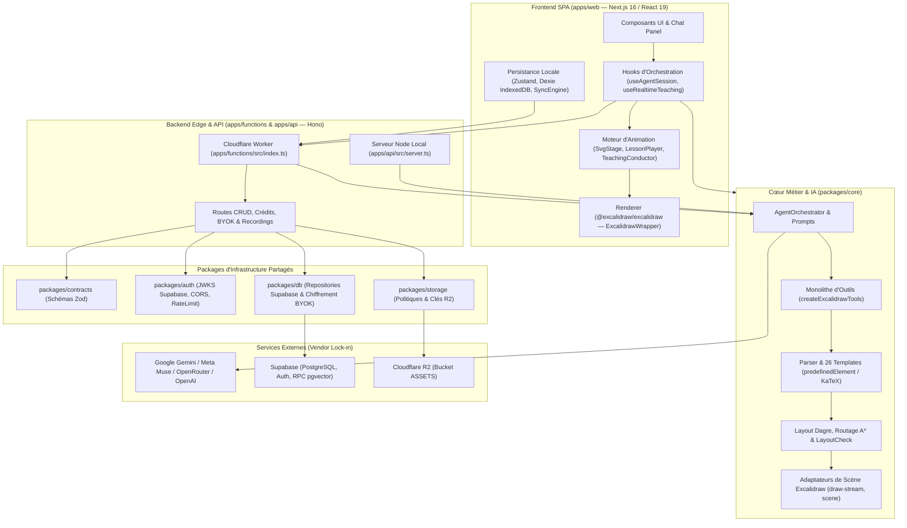

# 00 — Index d'Architecture Technique & Matrice de Couplage (`inklm`)

Ce répertoire documente l'architecture technique actuelle du monorepo **InkLM** ([`inklm/`](file:///c:/dev/_current_apps/whiteboard-ai-orchestrator/inklm/package.json)), les flux de données de bout en bout et l'inventaire systématique des **Points de Couplage (`Vendor Lock-in`)** qui devront être levés pour atteindre la cible de **Quadruple Indépendance** :
1. **Application-Agnostic** (indépendance vis-à-vis du backend Hono/Cloudflare/Supabase et de l'UI Next.js d'InkLM),
2. **Tool-Agnostic** (découplage du registre d'outils monolithique vers une architecture multi-agents : *Planner Agent*, *Specialized Domain Agents*, *Spatial Linter*),
3. **LLM-Agnostic** (indépendance vis-à-vis du Vercel AI SDK, des appels directs `@google/genai` et des prompts calibrés pour un modèle unique),
4. **Renderer-Agnostic** (introduction d'un *Universal Scene Graph* découplant le moteur géométrique de la librairie `@excalidraw/excalidraw`).

---

## 1. Topologie Globale du Monorepo et Flux de Dépendances

Le diagramme suivant illustre l'organisation actuelle des packages et applications au sein de l'espace de travail Turborepo + Bun :

---

## 2. Index des Plans d'Implémentation et d'Architecture

Chaque couche technique est analysée en détail dans un document dédié incluant ses diagrammes de séquence Mermaid et ses balises `> [!WARNING] Point de Couplage` :

| Réf. | Document Technique | Couche / Module Analysé | Principaux Fichiers Sources Inspectés |
| :--- | :--- | :--- | :--- |
| **01** | [**01_api_workers_et_contrats.md**](file:///c:/dev/_current_apps/whiteboard-ai-orchestrator/inklm/implementation_plans/01_api_workers_et_contrats.md) | **Couche Transport HTTP/SSE, Edge Worker, Auth & Crédits** | [`apps/functions/src/index.ts`](file:///c:/dev/_current_apps/whiteboard-ai-orchestrator/inklm/apps/functions/src/index.ts), [`apps/functions/src/crud.ts`](file:///c:/dev/_current_apps/whiteboard-ai-orchestrator/inklm/apps/functions/src/crud.ts), [`apps/functions/src/keys.ts`](file:///c:/dev/_current_apps/whiteboard-ai-orchestrator/inklm/apps/functions/src/keys.ts), [`apps/api/src/server.ts`](file:///c:/dev/_current_apps/whiteboard-ai-orchestrator/inklm/apps/api/src/server.ts), [`packages/auth/src/index.ts`](file:///c:/dev/_current_apps/whiteboard-ai-orchestrator/inklm/packages/auth/src/index.ts), [`packages/contracts/src/index.ts`](file:///c:/dev/_current_apps/whiteboard-ai-orchestrator/inklm/packages/contracts/src/index.ts) |
| **02** | [**02_pipeline_llm_et_outils.md**](file:///c:/dev/_current_apps/whiteboard-ai-orchestrator/inklm/implementation_plans/02_pipeline_llm_et_outils.md) | **Runtime Agent, Système de Prompts, Outils & Fournisseurs LLM/TTS/Live** | [`packages/core/src/agent/orchestrator.ts`](file:///c:/dev/_current_apps/whiteboard-ai-orchestrator/inklm/packages/core/src/agent/orchestrator.ts), [`packages/core/src/agent/tools.ts`](file:///c:/dev/_current_apps/whiteboard-ai-orchestrator/inklm/packages/core/src/agent/tools.ts), [`packages/core/src/agent/prompts.ts`](file:///c:/dev/_current_apps/whiteboard-ai-orchestrator/inklm/packages/core/src/agent/prompts.ts), [`packages/core/src/agent/speech.ts`](file:///c:/dev/_current_apps/whiteboard-ai-orchestrator/inklm/packages/core/src/agent/speech.ts), [`packages/core/src/agent/live.ts`](file:///c:/dev/_current_apps/whiteboard-ai-orchestrator/inklm/packages/core/src/agent/live.ts), [`packages/core/src/agent/sources.ts`](file:///c:/dev/_current_apps/whiteboard-ai-orchestrator/inklm/packages/core/src/agent/sources.ts) |
| **03** | [**03_moteur_geometrique_et_templates.md**](file:///c:/dev/_current_apps/whiteboard-ai-orchestrator/inklm/implementation_plans/03_moteur_geometrique_et_templates.md) | **Parsing Streaming, Expansion des 26 Templates, Layout Dagre, Routage A* & Linter Spatial** | [`packages/core/src/parser/normalizer.ts`](file:///c:/dev/_current_apps/whiteboard-ai-orchestrator/inklm/packages/core/src/parser/normalizer.ts), [`packages/core/src/parser/domain/predefined/expand.ts`](file:///c:/dev/_current_apps/whiteboard-ai-orchestrator/inklm/packages/core/src/parser/domain/predefined/expand.ts), [`packages/core/src/visual/layout.ts`](file:///c:/dev/_current_apps/whiteboard-ai-orchestrator/inklm/packages/core/src/visual/layout.ts), [`packages/core/src/visual/routing.ts`](file:///c:/dev/_current_apps/whiteboard-ai-orchestrator/inklm/packages/core/src/visual/routing.ts), [`packages/core/src/visual/layout-check.ts`](file:///c:/dev/_current_apps/whiteboard-ai-orchestrator/inklm/packages/core/src/visual/layout-check.ts), [`packages/core/src/math/svg.ts`](file:///c:/dev/_current_apps/whiteboard-ai-orchestrator/inklm/packages/core/src/math/svg.ts) |
| **04** | [**04_canvas_renderer_et_animation.md**](file:///c:/dev/_current_apps/whiteboard-ai-orchestrator/inklm/implementation_plans/04_canvas_renderer_et_animation.md) | **Intégration Frontend Excalidraw, SvgStage, DrawingDirector, LessonPlayer & TeachingConductor** | [`apps/web/src/components/excalidraw/ExcalidrawWrapper.tsx`](file:///c:/dev/_current_apps/whiteboard-ai-orchestrator/inklm/apps/web/src/components/excalidraw/ExcalidrawWrapper.tsx), [`apps/web/src/lib/stage/svg-stage.ts`](file:///c:/dev/_current_apps/whiteboard-ai-orchestrator/inklm/apps/web/src/lib/stage/svg-stage.ts), [`apps/web/src/lib/lesson-player.ts`](file:///c:/dev/_current_apps/whiteboard-ai-orchestrator/inklm/apps/web/src/lib/lesson-player.ts), [`apps/web/src/hooks/use-agent-session.ts`](file:///c:/dev/_current_apps/whiteboard-ai-orchestrator/inklm/apps/web/src/hooks/use-agent-session.ts), [`packages/core/src/director/drawing-director.ts`](file:///c:/dev/_current_apps/whiteboard-ai-orchestrator/inklm/packages/core/src/director/drawing-director.ts) |
| **05** | [**05_state_management_persistance_et_sync.md**](file:///c:/dev/_current_apps/whiteboard-ai-orchestrator/inklm/implementation_plans/05_state_management_persistance_et_sync.md) | **Stores Zustand, Réconciliation de Scène, Undo Ciblé, IndexedDB/Dexie, SyncEngine & Persistance DB/R2** | [`packages/core/src/adapters/scene.ts`](file:///c:/dev/_current_apps/whiteboard-ai-orchestrator/inklm/packages/core/src/adapters/scene.ts), [`packages/core/src/adapters/draw-stream.ts`](file:///c:/dev/_current_apps/whiteboard-ai-orchestrator/inklm/packages/core/src/adapters/draw-stream.ts), [`apps/web/src/lib/sync/sync-engine.ts`](file:///c:/dev/_current_apps/whiteboard-ai-orchestrator/inklm/apps/web/src/lib/sync/sync-engine.ts), [`packages/db/src/index.ts`](file:///c:/dev/_current_apps/whiteboard-ai-orchestrator/inklm/packages/db/src/index.ts), [`packages/storage/src/index.ts`](file:///c:/dev/_current_apps/whiteboard-ai-orchestrator/inklm/packages/storage/src/index.ts) |

---

## 3. Matrice Synthétique des Couplages vs. Quadruple Indépendance

| Dimension Cible | Couplage Actuel Majeur (Baseline) | Fichiers Critiques Impactés | Transformation Cible Requise |
| :--- | :--- | :--- | :--- |
| **Application-Agnostic** | L'orchestrateur IA est instancié directement dans les routes Hono du Worker avec des appels directs à Supabase (`canvasesRepo`, `threadsRepo`, `creditsRepo`) et au bucket R2 (`ASSETS`). Côté client, `useAgentSession` mêle transport HTTP, stores Zustand et appels Excalidraw. | [`apps/functions/src/index.ts`](file:///c:/dev/_current_apps/whiteboard-ai-orchestrator/inklm/apps/functions/src/index.ts#L789-L953) [`apps/web/src/hooks/use-agent-session.ts`](file:///c:/dev/_current_apps/whiteboard-ai-orchestrator/inklm/apps/web/src/hooks/use-agent-session.ts#L314-L532) | Isoler l'orchestrateur dans un runtime pur recevant des interfaces d'adaptateurs (`ContextProvider`, `AssetProvider`, `EventSink`) indépendantes d'InkLM. |
| **Tool-Agnostic** | Un seul agent LLM exécute une boucle `streamText` avec 12 outils définis dans une unique closure (`createExcalidrawTools`) partageant un état mutable en mémoire (`stream`, `lessonPlan`, `lessonIds`). | [`packages/core/src/agent/tools.ts`](file:///c:/dev/_current_apps/whiteboard-ai-orchestrator/inklm/packages/core/src/agent/tools.ts#L162-L674) [`packages/core/src/agent/orchestrator.ts`](file:///c:/dev/_current_apps/whiteboard-ai-orchestrator/inklm/packages/core/src/agent/orchestrator.ts#L167-L173) | Découper en **Pipeline Multi-Agents** : *Planner Agent* → *Specialized Domain Agents* (registres d'outils modulaires sans état partagé implicite) → *Spatial Linter*. |
| **LLM-Agnostic** | Dépendance forte à `streamText` / `UIMessage` (`ai`), `@ai-sdk/google`, `@ai-sdk/openai`, `@google/genai`, aux options propriétaires (`thinkingConfig`) et à un prompt système monolithique de 420+ lignes. | [`packages/core/src/agent/orchestrator.ts`](file:///c:/dev/_current_apps/whiteboard-ai-orchestrator/inklm/packages/core/src/agent/orchestrator.ts#L184-L222) [`packages/core/src/agent/prompts.ts`](file:///c:/dev/_current_apps/whiteboard-ai-orchestrator/inklm/packages/core/src/agent/prompts.ts#L5-L426) [`packages/core/src/agent/speech.ts`](file:///c:/dev/_current_apps/whiteboard-ai-orchestrator/inklm/packages/core/src/agent/speech.ts#L194-L280) | Introduire un port abstrait `LLMProvider` / `VoiceProvider` et fragmenter les prompts par sous-agent spécialisé pour réduire la pression sur la fenêtre de contexte. |
| **Renderer-Agnostic** | Le schéma de sortie du LLM, le normaliseur, les 26 templates métiers, la base de données et le moteur d'animation manipulent directement des primitives Excalidraw (`roughness`, `fillStyle`, `seed`, `roundness`, `exportToSvg`). | [`packages/core/src/core/types.ts`](file:///c:/dev/_current_apps/whiteboard-ai-orchestrator/inklm/packages/core/src/core/types.ts#L58-L214) [`packages/core/src/parser/normalizer.ts`](file:///c:/dev/_current_apps/whiteboard-ai-orchestrator/inklm/packages/core/src/parser/normalizer.ts#L351-L828) [`apps/web/src/lib/stage/svg-stage.ts`](file:///c:/dev/_current_apps/whiteboard-ai-orchestrator/inklm/apps/web/src/lib/stage/svg-stage.ts#L1-L120) | Intercaler un **Universal Scene Graph (USG)** comme représentation intermédiaire canonique, et reléguer Excalidraw au rôle de simple `RendererAdapter` en bout de chaîne. |
