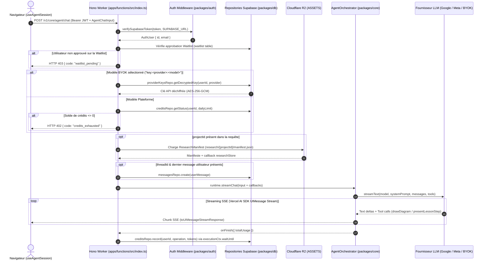

# 01 — Couche API, Edge Workers, Contrats & Authentification

Ce document détaille l'architecture de la couche de transport HTTP/SSE d'InkLM répartie entre le Cloudflare Worker principal ([`apps/functions/src/index.ts`](file:///c:/dev/_current_apps/whiteboard-ai-orchestrator/inklm/apps/functions/src/index.ts)), le serveur Node de développement ([`apps/api/src/server.ts`](file:///c:/dev/_current_apps/whiteboard-ai-orchestrator/inklm/apps/api/src/server.ts)), les schémas de validation ([`packages/contracts/src/index.ts`](file:///c:/dev/_current_apps/whiteboard-ai-orchestrator/inklm/packages/contracts/src/index.ts)) et le middleware de sécurité ([`packages/auth/src/index.ts`](file:///c:/dev/_current_apps/whiteboard-ai-orchestrator/inklm/packages/auth/src/index.ts)).

---

## 1. Flux d'Exécution Technique : Cycle de Vie d'une Requête `/v1/core/agent/chat`

Le diagramme de séquence ci-dessous retrace le cheminement exact d'une requête conversationnelle et graphique depuis le navigateur jusqu'à la persistance post-stream dans le Cloudflare Worker :

---

## 2. Cartographie des Routes Exposées par le Worker (`apps/functions`)

| Groupe Fonctionnel | Fichier Source | Endpoints Principaux | Responsabilités Techniques |
| :--- | :--- | :--- | :--- |
| **Orchestration IA & Voix** | [`apps/functions/src/index.ts`](file:///c:/dev/_current_apps/whiteboard-ai-orchestrator/inklm/apps/functions/src/index.ts#L586-L1085) | `POST /v1/core/agent/chat` `POST /v1/core/agent/speech` `POST /v1/core/agent/live-token` `POST /v1/core/agent/plan-lesson` `POST /v1/core/agent/research` `POST /v1/core/research/ingest` | Exécution de l'orchestrateur, synthèse TTS, émission de jetons éphémères Gemini Live, génération SSE de cues visuels, ingestion documentaire R2. |
| **Stockage Objet R2** | [`apps/functions/src/index.ts`](file:///c:/dev/_current_apps/whiteboard-ai-orchestrator/inklm/apps/functions/src/index.ts#L298-L459) | `POST /v1/storage/presign-upload` `POST /v1/storage/upload` `GET /v1/storage/object/*` `POST /v1/storage/snapshots` | Validation MIME/taille via [`validateUploadPolicy`](file:///c:/dev/_current_apps/whiteboard-ai-orchestrator/inklm/packages/storage/src/index.ts#L47-L69), lecture/écriture directe dans le binding R2 `c.env.ASSETS`. |
| **CRUD Métier & Versions** | [`apps/functions/src/crud.ts`](file:///c:/dev/_current_apps/whiteboard-ai-orchestrator/inklm/apps/functions/src/crud.ts#L121-L580) | `POST /v1/waitlist` `POST /v1/auth/magic-link` `GET /v1/me` `/v1/projects/*` `/v1/canvases/*` | Gestion des projets, canevas, threads, messages et création atomique de versions avec garde-fou [`checkBoardSave`](file:///c:/dev/_current_apps/whiteboard-ai-orchestrator/inklm/apps/functions/src/crud.ts#L50-L92). |
| **Coffre-fort BYOK** | [`apps/functions/src/keys.ts`](file:///c:/dev/_current_apps/whiteboard-ai-orchestrator/inklm/apps/functions/src/keys.ts#L31-L165) | `GET /v1/keys` `POST /v1/keys/check` `POST /v1/keys` `PATCH /v1/keys/:provider` `DELETE /v1/keys/:provider` | Test de validité des clés API externes, découverte des modèles compatibles, chiffrement AES-256-GCM en base. |
| **Enregistrements & Feedback** | [`apps/functions/src/recordings.ts`](file:///c:/dev/_current_apps/whiteboard-ai-orchestrator/inklm/apps/functions/src/recordings.ts) [`apps/functions/src/feedback.ts`](file:///c:/dev/_current_apps/whiteboard-ai-orchestrator/inklm/apps/functions/src/feedback.ts) | `PUT /v1/recordings/:id/segments/:idx` `PUT /v1/recordings/:id/manifest` `POST /v1/feedback` | Stockage segmenté des leçons audio/scène et archivage de bundles ZIP de diagnostic lors d'un pouce bas utilisateur. |

---

## 3. Analyse des Points de Couplage (Vendor Lock-in & Dette Architecturale)

### 3.1 Couplage Fort entre la Route HTTP, Supabase, Cloudflare R2 et l'Orchestrateur IA

> [!WARNING] Point de Couplage — Orchestration Embarquée dans le Handler Cloudflare Worker
> Dans [`apps/functions/src/index.ts`](file:///c:/dev/_current_apps/whiteboard-ai-orchestrator/inklm/apps/functions/src/index.ts#L789-L953), le handler `app.post("/v1/core/agent/chat", ...)` mêle dans une même fonction :
> 1. La vérification de la table `waitlist` et le calcul des quotas Supabase (`creditsRepo`),
> 2. Le déchiffrement des clés BYOK (`providerKeysRepo`),
> 3. L'accès direct au bucket Cloudflare R2 `c.env.ASSETS` pour construire un `researchStore` ad-hoc (`getManifest`, `getSource`),
> 4. L'interrogation RPC Supabase `libraryRepo.search` injectée comme callback `searchAssetLibrary`,
> 5. L'écriture directe du message utilisateur dans `messagesRepo.create`,
> 6. La sérialisation de la réponse au format propriétaire Vercel AI SDK via `result.toUIMessageStreamResponse()`.
>
> **Impact sur la cible Application-Agnostic** : Il est impossible d'exécuter l'orchestrateur complet hors de l'environnement Cloudflare + Supabase d'InkLM sans réécrire ce câblage.

### 3.2 Divergence et Duplication entre `apps/functions` et `apps/api`

> [!WARNING] Point de Couplage — Double Point d'Entrée Backend Non Unifié
> Le serveur Node [`apps/api/src/server.ts`](file:///c:/dev/_current_apps/whiteboard-ai-orchestrator/inklm/apps/api/src/server.ts#L1-L165) réimplémente manuellement un sous-ensemble des routes (`/v1/core/agent/chat` et `/v1/core/agent/speech`) sans support du `researchStore`, sans recherche d'assets vectoriels (`searchAssetLibrary`), sans gestion BYOK ni routes `/v1/core/agent/plan-lesson` ou `/v1/core/agent/live-token`.
>
> **Impact** : Le comportement de l'agent diffère selon qu'il est appelé via `apps/api` ou via `apps/functions`.

### 3.3 Couplage du Protocole de Streaming au Format `UIMessage` du Vercel AI SDK

> [!WARNING] Point de Couplage — Contrat Réseau Verrouillé sur Vercel AI SDK (`ai`)
> Tant [`apps/functions/src/index.ts`](file:///c:/dev/_current_apps/whiteboard-ai-orchestrator/inklm/apps/functions/src/index.ts#L918-L949) que [`apps/api/src/server.ts`](file:///c:/dev/_current_apps/whiteboard-ai-orchestrator/inklm/apps/api/src/server.ts#L140-L152) retournent directement `result.toUIMessageStreamResponse()`. Le contrat d'entrée [`AgentChatInput`](file:///c:/dev/_current_apps/whiteboard-ai-orchestrator/inklm/packages/core/src/agent/orchestrator.ts#L33-L55) impose `messages: UIMessage[]` (type importé de `"ai"`).
>
> **Impact sur la cible LLM-Agnostic & Application-Agnostic** : Le protocole SSE entre le backend et le frontend n'est pas un contrat métier agnostique mais le format interne de sérialisation de `useChat` (`@ai-sdk/react`).

### 3.4 Politique CORS et Rate-Limiter Liés à l'Environnement InkLM

> [!WARNING] Point de Couplage — Origines CORS Codées en Dur et Rate-Limiter Non Distribué
> Dans [`packages/auth/src/index.ts`](file:///c:/dev/_current_apps/whiteboard-ai-orchestrator/inklm/packages/auth/src/index.ts#L103-L148) :
> - La fonction [`isAllowedOrigin`](file:///c:/dev/_current_apps/whiteboard-ai-orchestrator/inklm/packages/auth/src/index.ts#L103-L119) code en dur les domaines `https://inklm.com` et `https://www.inklm.com`.
> - Le limiteur de débit [`createInMemoryRateLimiter`](file:///c:/dev/_current_apps/whiteboard-ai-orchestrator/inklm/packages/auth/src/index.ts#L150-L185) stocke les compteurs dans une `Map` JavaScript locale à l'isolat V8, qui est réinitialisée à chaque recyclage d'isolat Cloudflare Worker et n'est pas partagée entre les nœuds Edge.
