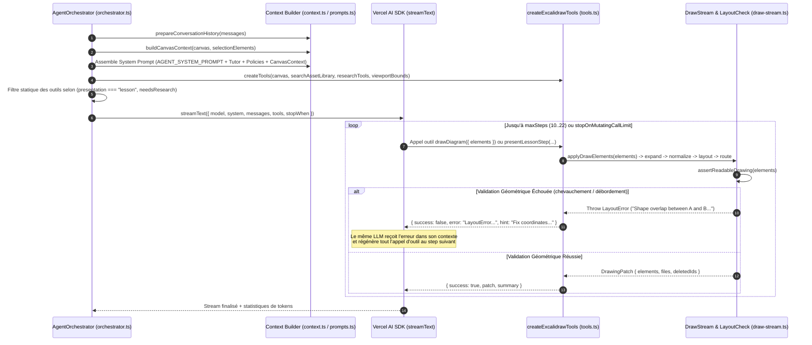

# 02 — Pipeline LLM, Système de Prompts & Registre d'Outils

Ce document analyse en détail l'implémentation actuelle du moteur d'intelligence artificielle dans [`packages/core/src/agent/`](file:///c:/dev/_current_apps/whiteboard-ai-orchestrator/inklm/packages/core/src/agent/orchestrator.ts) : l'assemblage du prompt système, la boucle d'exécution mono-agent `streamText`, le registre d'outils [`createExcalidrawTools`](file:///c:/dev/_current_apps/whiteboard-ai-orchestrator/inklm/packages/core/src/agent/tools.ts#L162-L674), ainsi que les intégrations vocales ([`speech.ts`](file:///c:/dev/_current_apps/whiteboard-ai-orchestrator/inklm/packages/core/src/agent/speech.ts)) et temps réel ([`live.ts`](file:///c:/dev/_current_apps/whiteboard-ai-orchestrator/inklm/packages/core/src/agent/live.ts)).

---

## 1. Flux d'Exécution Technique : Boucle Mono-Agent & Auto-Correction Géométrique

Actuellement, un **unique agent LLM** cumule les rôles de planificateur, de rédacteur pédagogique, de générateur de primitives graphiques et de correcteur spatial au sein d'une seule boucle `streamText` :

---

## 2. Anatomie du Prompt Système Assemblé

Lors de chaque appel à [`AgentOrchestrator.streamChat`](file:///c:/dev/_current_apps/whiteboard-ai-orchestrator/inklm/packages/core/src/agent/orchestrator.ts#L139-L279), la fonction [`buildSystemPrompt`](file:///c:/dev/_current_apps/whiteboard-ai-orchestrator/inklm/packages/core/src/agent/orchestrator.ts#L60-L129) concatène séquentiellement jusqu'à **9 blocs d'instructions** dans un seul prompt système massif :
1. **Base Excalidraw & Identité InkLM** : [`AGENT_SYSTEM_PROMPT`](file:///c:/dev/_current_apps/whiteboard-ai-orchestrator/inklm/packages/core/src/agent/prompts.ts#L5-L343) (~340 lignes décrivant l'identité *"You are InkLM"*, les coordonnées Excalidraw, la palette de couleurs hexadécimales, les règles `roughness`/`fillStyle` et la syntaxe des 26 `predefinedElement`).
2. **Contrat de Mode Leçon (Optionnel)** : [`LESSON_SYSTEM_PROMPT`](file:///c:/dev/_current_apps/whiteboard-ai-orchestrator/inklm/packages/core/src/agent/prompts.ts#L345-L426) si `presentation === "lesson"`.
3. **Spécialisation Disciplinaire** : [`tutorPromptBlock(input.tutor)`](file:///c:/dev/_current_apps/whiteboard-ai-orchestrator/inklm/packages/core/src/agent/tutors.ts#L65-L68) (`general`, `it`, `math`, `physics`, `medical`).
4. **Politiques Conditionnelles d'Intention** : [`buildChartPolicyBlock`](file:///c:/dev/_current_apps/whiteboard-ai-orchestrator/inklm/packages/core/src/agent/policy.ts#L63-L73) et [`buildComparisonPolicyBlock`](file:///c:/dev/_current_apps/whiteboard-ai-orchestrator/inklm/packages/core/src/agent/policy.ts#L75-L84).
5. **Garde-fou de Suppression/Édition** : Règles interdisant `deleteElementIds` ou `clearBoard` si `hasExplicitDeleteIntent` / `hasExplicitClearIntent` valent `false`.
6. **Mémoire Conversationnelle Résumée** : Résumé textuel des tours anciens (`olderTurnsSummary`).
7. **Contexte Documentaire (Optionnel)** : [`buildResearchContextBlock`](file:///c:/dev/_current_apps/whiteboard-ai-orchestrator/inklm/packages/core/src/agent/research-tools.ts#L400-L435) listant les documents du `ResearchManifest`.
8. **État Spatial du Canevas** : [`formatCanvasContextForPrompt`](file:///c:/dev/_current_apps/whiteboard-ai-orchestrator/inklm/packages/core/src/agent/context.ts#L298-L370) sérialisant les groupes de proximité, le viewport et les éléments du dernier groupe actif.
9. **Sélection Active de l'Utilisateur** : Élément(s) actuellement sélectionné(s) par l'utilisateur sur le tableau.

---

## 3. Analyse des Points de Couplage (LLM-Agnostic & Tool-Agnostic)

### 3.1 Registre d'Outils Monolithique à État Partagé (`createExcalidrawTools`)

> [!WARNING] Point de Couplage — Closure Monolithique et État Mutable Partagé entre Outils
> Dans [`packages/core/src/agent/tools.ts`](file:///c:/dev/_current_apps/whiteboard-ai-orchestrator/inklm/packages/core/src/agent/tools.ts#L162-L674), la fonction `createExcalidrawTools` instancie dans une seule closure l'ensemble des outils (`drawDiagram`, `planLesson`, `presentLessonStep`, `readCanvasGroup`, `clearBoard`, `searchLibraryAssets`, `searchImages`) autour de variables locales mutables :
> - `const stream = createDrawStream(canvas, { viewportBounds })` (ligne 172),
> - `let lessonPlan: LessonPlan | null = null` (ligne 178),
> - `const lessonIds = new Set<string>()` (ligne 179),
> - `const lessonTones: SpeechTone[] = []` (ligne 180),
> - `const imageCandidates = new Map<string, ImageCandidate>()` (ligne 181).
>
> **Impact sur la cible Tool-Agnostic** : Les outils ne sont pas des unités indépendantes et composables ; `presentLessonStep` dépend de l'état laissé en mémoire par `planLesson` et `searchImages` dans la même instance de closure, empêchant toute distribution vers des sous-agents spécialisés (*Specialized Domain Agents*).

### 3.2 Absence de Séparation entre Planification, Génération Métier et Validation Spatiale

> [!WARNING] Point de Couplage — Boucle Mono-Agent Surchargée au lieu d'un Pipeline Multi-Agents
> Dans [`packages/core/src/agent/orchestrator.ts`](file:///c:/dev/_current_apps/whiteboard-ai-orchestrator/inklm/packages/core/src/agent/orchestrator.ts#L167-L265), un seul appel `streamText` reçoit simultanément les instructions de tous les domaines et les 26 spécifications de templates (`AGENT_SYSTEM_PROMPT`). Lorsqu'un schéma échoue au contrôle [`assertReadableDrawing`](file:///c:/dev/_current_apps/whiteboard-ai-orchestrator/inklm/packages/core/src/visual/layout-check.ts#L316-L364), l'erreur géométrique est renvoyée dans la conversation principale du LLM (consommant des tokens et des steps sur le modèle principal).
>
> **Impact sur l'Architecture Cible** : Cette conception s'oppose directement au pipeline cible (**Planner Agent** → **Agents Spécialisés par Domaine** → **Linter Spatial autonome**).

### 3.3 Couplage Direct aux SDKs Fournisseurs et aux Modèles Codés en Dur

> [!WARNING] Point de Couplage — Instanciation Directe des Clients LLM et Options Propriétaires
> Plusieurs modules de `packages/core` et `apps/functions` codent en dur les SDKs et identifiants de modèles :
> 1. **Orchestrateur Principal ([`orchestrator.ts`](file:///c:/dev/_current_apps/whiteboard-ai-orchestrator/inklm/packages/core/src/agent/orchestrator.ts#L184-L250))** : Importe directement `createGoogleGenerativeAI` (`@ai-sdk/google`) et `createOpenAI` (`@ai-sdk/openai`), code en dur l'URL `https://api.meta.ai/v1`, les en-têtes `HTTP-Referer: "https://inklm.com"`, le modèle par défaut `gemini-3.8-flash`, et injecte `providerOptions: { google: { thinkingConfig: { thinkingBudget } } }`.
> 2. **Mode Live & Planificateur Temps Réel ([`apps/functions/src/index.ts`](file:///c:/dev/_current_apps/whiteboard-ai-orchestrator/inklm/apps/functions/src/index.ts#L586-L742))** : Instancie directement `new GoogleGenAI({ apiKey, httpOptions: { apiVersion: "v1alpha" } })` (`@google/genai`) avec `GEMINI_LIVE_MODEL = "gemini-3.8-live"` et force `model: "gemini-3.8-flash"` dans `/v1/core/agent/plan-lesson`.
> 3. **Recherche Web Grounding ([`sources.ts`](file:///c:/dev/_current_apps/whiteboard-ai-orchestrator/inklm/packages/core/src/agent/sources.ts#L172-L184))** : Verrouillé sur `createGoogleGenerativeAI` et l'outil propriétaire `google.tools.googleSearch({})`.
> 4. **Synthèse Vocale ([`speech.ts`](file:///c:/dev/_current_apps/whiteboard-ai-orchestrator/inklm/packages/core/src/agent/speech.ts#L98-L192))** : Appelle en dur `https://openrouter.ai/api/v1/chat/completions` avec le modèle `heygen/heygen-voice-1-turbo:free` et `https://generativelanguage.googleapis.com/v1beta/interactions` avec `gemini-3.8-flash-lite-tts`.

### 3.4 Couplage du Prompt Système à la Grammaire Excalidraw

> [!WARNING] Point de Couplage — Prompts Calibrés sur les Primitives Bas-Niveau d'Excalidraw
> Dans [`packages/core/src/agent/prompts.ts`](file:///c:/dev/_current_apps/whiteboard-ai-orchestrator/inklm/packages/core/src/agent/prompts.ts#L5-L343) et [`packages/core/src/agent/tutors.ts`](file:///c:/dev/_current_apps/whiteboard-ai-orchestrator/inklm/packages/core/src/agent/tutors.ts#L17-L51), le LLM reçoit l'instruction explicite de produire des attributs propres à Excalidraw (`roughness: 0`, `fillStyle: "hachure"`, `roundness: { "type": 2 }`, `fontFamily: 3`, `startBinding`, `endBinding`).
>
> **Impact sur la cible Renderer-Agnostic & LLM-Agnostic** : Le LLM est contraint de raisonner comme un sérialiseur Excalidraw au lieu d'émettre des intentions sémantiques vers un *Universal Scene Graph*.
