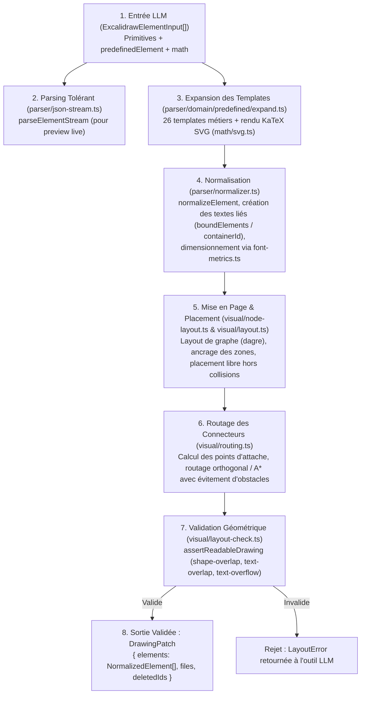

# 03 — Moteur Géométrique, Templates Métiers, Layout & Routage

Ce document analyse le pipeline interne de transformation géométrique situé dans [`packages/core/src/parser/`](file:///c:/dev/_current_apps/whiteboard-ai-orchestrator/inklm/packages/core/src/parser/normalizer.ts), [`packages/core/src/math/`](file:///c:/dev/_current_apps/whiteboard-ai-orchestrator/inklm/packages/core/src/math/svg.ts) et [`packages/core/src/visual/`](file:///c:/dev/_current_apps/whiteboard-ai-orchestrator/inklm/packages/core/src/visual/index.ts). Il retrace comment les intentions déclaratives du LLM (`ExcalidrawElementInput`) sont converties en primitives coordonnées (`NormalizedElement`), mises en page via `dagre`, routées via A* et vérifiées par le linter spatial (`assertReadableDrawing`).

---

## 1. Flux d'Exécution Technique : Du JSON LLM au `DrawingPatch` Validé

Le diagramme suivant illustre les 7 étapes de transformation exécutées lors d'un appel à [`applyDrawElements`](file:///c:/dev/_current_apps/whiteboard-ai-orchestrator/inklm/packages/core/src/adapters/draw-stream.ts#L81-L157) :

---

## 2. Détail des Sous-Systèmes Géométriques

### 2.1 Expansion des 26 Templates Métiers (`parser/domain/predefined/`)
- Le répartiteur [`expandPredefinedElement`](file:///c:/dev/_current_apps/whiteboard-ai-orchestrator/inklm/packages/core/src/parser/domain/predefined/expand.ts#L45-L185) aiguille chaque `identifier` vers son générateur dédié :
  - **Mermaid (`mermaid.ts`)** : Parse la syntaxe Mermaid (`flowchart`, `sequenceDiagram`, `stateDiagram-v2`, `classDiagram`) et génère directement des conteneurs, lignes de vie, boîtes d'activation et flèches Excalidraw.
  - **Structures de Données (`structure.ts`)** : Génère des cellules indexées avec identifiants déterministes (`{id}_cell_{i}`, `{id}_node_{k}`) permettant à [`lesson/direction.ts`](file:///c:/dev/_current_apps/whiteboard-ai-orchestrator/inklm/packages/core/src/lesson/direction.ts) d'appliquer ultérieurement des mutations algorithmiques (`swap`, `highlight`, `push`, `pop`).
  - **Sciences & Mathématiques (`math.ts`, `plot.ts`, `geometry.ts`, `physics.ts`, `circuit.ts`, `anatomy.ts`)** : Évalue les expressions mathématiques en sécurité, échantillonne les courbes et construit les symboles physiques/électriques à partir de segments, arcs et polygones.

### 2.2 Rendu Mathématique LaTeX & Ancres Sous-Éléments (`math/svg.ts`)
- [`renderMathSvg`](file:///c:/dev/_current_apps/whiteboard-ai-orchestrator/inklm/packages/core/src/math/svg.ts) utilise **KaTeX** + **MathJax SVG** pour convertir une expression LaTeX en image vectorielle SVG autonome (`data:image/svg+xml;base64,...`).
- Les macros personnalisées `\part{name}{expr}` sont interceptées pour calculer les coordonnées relatives (`subParts: Record<string, BoundingBox>`) de chaque sous-terme de l'équation, stockées dans `element.customData.math.parts`. Cela permet au pointeur pédagogique de viser `"eq1#terme"` au milieu d'une formule.

### 2.3 Mise en Page Automatique (`visual/node-layout.ts` & `visual/layout.ts`)
- **Dagre Layout** : Les graphes dont les nœuds n'ont pas de coordonnées explicites ou présentent des collisions initiales sont passés à `dagre` pour calculer un placement hiérarchique (`TB`, `LR`) respectant les dimensions réelles des labels.
- **Placement de Section sur le Canevas** : [`placeNewDiagramCluster`](file:///c:/dev/_current_apps/whiteboard-ai-orchestrator/inklm/packages/core/src/visual/layout.ts) cherche un emplacement libre à droite ou en dessous des groupes existants, en tenant compte de `viewportBounds` afin que le nouveau dessin apparaisse dans le champ de vision de l'utilisateur sans écraser les schémas précédents.

### 2.4 Routage des Flèches (`visual/routing.ts`) & Linter Spatial (`visual/layout-check.ts`)
- [`routeArrows`](file:///c:/dev/_current_apps/whiteboard-ai-orchestrator/inklm/packages/core/src/visual/routing.ts) calcule les ancres optimales sur les bords des formes sources/cibles (`startBinding`, `endBinding`) et trace un chemin orthogonal (`elbowed: true`) ou multi-points évitant les boîtes englobantes intermédiaires.
- [`assertReadableDrawing`](file:///c:/dev/_current_apps/whiteboard-ai-orchestrator/inklm/packages/core/src/visual/layout-check.ts#L316-L364) inspecte le patch final et lève une exception descriptive si deux formes se chevauchent, si deux textes se superposent ou si un label déborde de son conteneur.

---

## 3. Analyse des Points de Couplage (Obstacle Majeur au *Renderer-Agnostic*)

### 3.1 Absence de *Universal Scene Graph* : Expansion Directe vers Excalidraw

> [!WARNING] Point de Couplage — Les 26 Templates Métiers Produisent Directement des Primitives Excalidraw
> Dans [`packages/core/src/parser/domain/predefined/expand.ts`](file:///c:/dev/_current_apps/whiteboard-ai-orchestrator/inklm/packages/core/src/parser/domain/predefined/expand.ts#L45-L185) et tous ses sous-modules (`mermaid.ts`, `structure.ts`, `plot.ts`, `circuit.ts`, `physics.ts`, etc.), les fonctions d'expansion retournent directement `ExcalidrawElementInput[]` avec des propriétés spécifiques à Excalidraw :
> - `roughness: 0 | 1`, `fillStyle: "solid" | "hachure"`, `roundness: { type: 2 | 3 }`,
> - `fontFamily: 1 | 2 | 3` (identifiants numériques internes d'Excalidraw pour Virgil, Helvetica, Cascadia),
> - `startBinding` / `endBinding` et `elbowed: true`.
>
> **Impact sur la cible Renderer-Agnostic** : Toute la richesse géométrique des 26 templates métiers est aujourd'hui fusionnée avec le format de sérialisation Excalidraw. Pour supporter un autre moteur de rendu (Canvas 2D natif, Three.js/WebGL 3D, SVG pur, tldraw, React Flow), il faut introduire un **Universal Scene Graph (USG)** en sortie des templates et déporter la conversion Excalidraw dans un adaptateur dédié.

### 3.2 Modèle de Texte Lié Spécifique à Excalidraw (`containerId` / `boundElements`)

> [!WARNING] Point de Couplage — Dualité Conteneur/Texte Propre à Excalidraw dans `normalizer.ts`
> Dans [`packages/core/src/parser/normalizer.ts`](file:///c:/dev/_current_apps/whiteboard-ai-orchestrator/inklm/packages/core/src/parser/normalizer.ts#L351-L828), lorsqu'une forme (`rectangle`, `ellipse`, `diamond`) porte une propriété `text` ou `label`, `normalizeElement` la scinde en **deux éléments distincts** liés par `containerId` (sur l'élément `text`) et `boundElements: [{ id, type: "text" }]` (sur la forme parente), et génère des nombres aléatoires `seed` et `versionNonce` propres au moteur `roughjs` d'Excalidraw.
>
> **Impact** : Les algorithmes ultérieurs (`visual/layout.ts`, `visual/layout-check.ts`, `adapters/drawing-reveal.ts`) doivent constamment reconstruire l'association entre une boîte et son élément `text` séparé via `containerId`.

### 3.3 Calcul de Dimensions Basé sur les Métriques de Police Excalidraw (`font-metrics.ts`)

> [!WARNING] Point de Couplage — Tables de Largeur de Glyphes Calibrées sur Virgil / Excalifont
> Le fichier [`packages/core/src/core/font-metrics.ts`](file:///c:/dev/_current_apps/whiteboard-ai-orchestrator/inklm/packages/core/src/core/font-metrics.ts) mesure la largeur et la hauteur des textes (et détermine si [`assertReadableDrawing`](file:///c:/dev/_current_apps/whiteboard-ai-orchestrator/inklm/packages/core/src/visual/layout-check.ts) déclenche une erreur `text-overflow`) en utilisant les ratios de glyphes codés en dur pour les 3 polices internes d'Excalidraw (`fontFamily: 1 | 2 | 3`).

### 3.4 Encapsulation des Formules Mathématiques en Éléments `image` Excalidraw

> [!WARNING] Point de Couplage — Contournement du Rendu Mathématique via `fileId` et `BinaryFiles` Excalidraw
> Excalidraw ne supportant pas nativement les nœuds LaTeX/MathML, [`packages/core/src/parser/normalizer.ts`](file:///c:/dev/_current_apps/whiteboard-ai-orchestrator/inklm/packages/core/src/parser/normalizer.ts) et [`packages/core/src/lesson/direction.ts`](file:///c:/dev/_current_apps/whiteboard-ai-orchestrator/inklm/packages/core/src/lesson/direction.ts) convertissent chaque équation en un élément Excalidraw de type `"image"` référençant un `fileId` injecté dans la map `BinaryFiles` d'Excalidraw, tout en cachant l'arbre sémantique des sous-termes dans `customData.math`.
