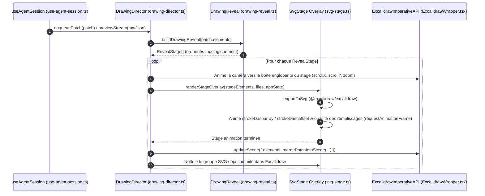
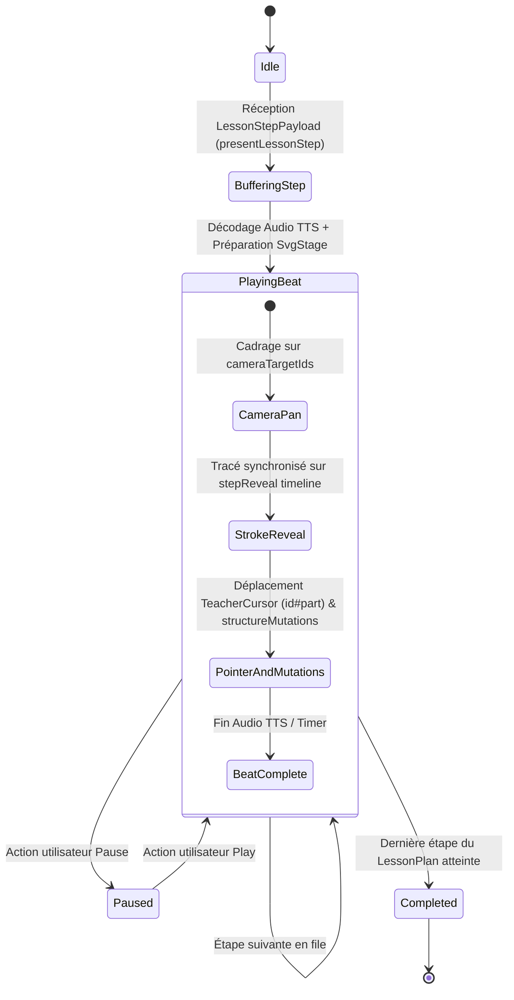

# 04 — Canvas Renderer, Stage d'Animation SVG & Lecteurs de Leçons

Ce document analyse la couche de rendu graphique et d'animation côté client située dans [`apps/web/src/components/excalidraw/ExcalidrawWrapper.tsx`](file:///c:/dev/_current_apps/whiteboard-ai-orchestrator/inklm/apps/web/src/components/excalidraw/ExcalidrawWrapper.tsx), [`apps/web/src/lib/stage/svg-stage.ts`](file:///c:/dev/_current_apps/whiteboard-ai-orchestrator/inklm/apps/web/src/lib/stage/svg-stage.ts), [`packages/core/src/director/drawing-director.ts`](file:///c:/dev/_current_apps/whiteboard-ai-orchestrator/inklm/packages/core/src/director/drawing-director.ts), [`apps/web/src/lib/lesson-player.ts`](file:///c:/dev/_current_apps/whiteboard-ai-orchestrator/inklm/apps/web/src/lib/lesson-player.ts) et [`apps/web/src/lib/live/teaching-conductor.ts`](file:///c:/dev/_current_apps/whiteboard-ai-orchestrator/inklm/apps/web/src/lib/live/teaching-conductor.ts).

---

## 1. Flux d'Exécution Technique : Du `DrawingPatch` au Rendu Animé sur le Canevas

Pour donner l'illusion d'un professeur dessinant trait par trait au tableau sans souffrir des lenteurs de re-rendu Canvas 2D d'Excalidraw à 60 FPS, InkLM utilise une architecture à **double couche** : une surcouche temporaire SVG (`SvgStage`) qui anime l'apparition des nouveaux éléments par-dessus le canevas Excalidraw avant de les commiter dans la scène finale :

---

## 2. Orchestration Temporelle des Modes `lesson` et `realtime`

---

## 3. Analyse des Points de Couplage (Renderer Lock-in & Couplage Client)

### 3.1 Dépendance Directe du Moteur d'Animation `SvgStage` aux Internals d'Excalidraw

> [!WARNING] Point de Couplage — `SvgStage` Dépend de `exportToSvg` et des Coordonnées d'Excalidraw
> Dans [`apps/web/src/lib/stage/svg-stage.ts`](file:///c:/dev/_current_apps/whiteboard-ai-orchestrator/inklm/apps/web/src/lib/stage/svg-stage.ts#L1-L140), le moteur d'animation par traits importe directement depuis `@excalidraw/excalidraw` :
> - `exportToSvg` pour convertir les éléments en nœuds DOM `<svg>` générés par `roughjs`,
> - `getCommonBounds` et `sceneCoordsToViewportCoords` pour aligner le calque SVG avec le `scrollX`, `scrollY` et `zoom.value` de l'état interne `AppState` d'Excalidraw.
>
> **Impact sur la cible Renderer-Agnostic** : Le système de révélation progressive (`SvgStage`) ne peut animer que des éléments Excalidraw exportés via `exportToSvg`.

### 3.2 Couplage du Hook `useAgentSession` au Cycle de Vie Client et aux Stores Zustand

> [!WARNING] Point de Couplage — Logique d'Orchestration et de Réconciliation Exécutée dans un Hook React
> Le fichier [`apps/web/src/hooks/use-agent-session.ts`](file:///c:/dev/_current_apps/whiteboard-ai-orchestrator/inklm/apps/web/src/hooks/use-agent-session.ts#L314-L619) (~650 lignes) concentre simultanément :
> 1. L'intégration avec `useChat` (`@ai-sdk/react`),
> 2. L'inspection par nom des outils (`toolName === "drawDiagram"`, `"presentLessonStep"`, `"planLesson"`, `"clearBoard"`) dans les parts de `UIMessage`,
> 3. Le pilotage direct de [`createDrawingDirector`](file:///c:/dev/_current_apps/whiteboard-ai-orchestrator/inklm/packages/core/src/director/drawing-director.ts) et de [`LessonPlayer`](file:///c:/dev/_current_apps/whiteboard-ai-orchestrator/inklm/apps/web/src/lib/lesson-player.ts),
> 4. La lecture/écriture directe dans les stores Zustand (`useEditorStore`, `useProjectCacheStore`) et le déclenchement d'effets de bord applicatifs (`nameBlankBoard`).
>
> **Impact sur la cible Application-Agnostic & Tool-Agnostic** : L'ajout d'un nouvel outil visuel ou d'un sous-agent spécialisé oblige à modifier le code React du client (`use-agent-session.ts`) qui filtre en dur les noms d'outils (`drawDiagram`, `presentLessonStep`).

### 3.3 Manipulation Impérative Directe de `ExcalidrawImperativeAPI`

> [!WARNING] Point de Couplage — Absence d'Interface `CanvasRenderer` Abstraite
> Dans [`apps/web/src/components/excalidraw/ExcalidrawWrapper.tsx`](file:///c:/dev/_current_apps/whiteboard-ai-orchestrator/inklm/apps/web/src/components/excalidraw/ExcalidrawWrapper.tsx), [`apps/web/src/lib/lesson-player.ts`](file:///c:/dev/_current_apps/whiteboard-ai-orchestrator/inklm/apps/web/src/lib/lesson-player.ts) et [`apps/web/src/hooks/use-canvas-page-controller.ts`](file:///c:/dev/_current_apps/whiteboard-ai-orchestrator/inklm/apps/web/src/hooks/use-canvas-page-controller.ts), la caméra, la sélection, l'injection de fichiers binaires (`addFiles`) et la mise à jour de scène (`updateScene`) appellent directement les méthodes de `ExcalidrawImperativeAPI` sans passer par un contrat d'abstraction de moteur de rendu (`RendererAdapter`).

### 3.4 Export PowerPoint (`.pptx`) Couplé aux Primitives Excalidraw

> [!WARNING] Point de Couplage — Convertisseur PPTX Lié au Format `NormalizedElement` d'Excalidraw
> Dans [`packages/core/src/lesson/pptx.ts`](file:///c:/dev/_current_apps/whiteboard-ai-orchestrator/inklm/packages/core/src/lesson/pptx.ts), la génération des diapositives PowerPoint lit directement les propriétés Excalidraw (`elements`, `files`, `strokeColor`, `backgroundColor`, `boundElements`) de chaque étape de la leçon.
