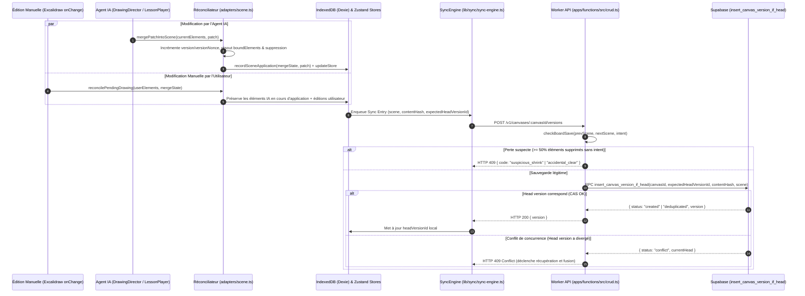

# 05 — State Management, Réconciliation de Scène, Persistance & Synchronisation

Ce document analyse l'architecture de gestion d'état et de persistance à travers les couches cliente, partagée et serveur :
- **Réconciliation de scène et Undo ciblé** dans [`packages/core/src/adapters/scene.ts`](file:///c:/dev/_current_apps/whiteboard-ai-orchestrator/inklm/packages/core/src/adapters/scene.ts), [`packages/core/src/adapters/draw-stream.ts`](file:///c:/dev/_current_apps/whiteboard-ai-orchestrator/inklm/packages/core/src/adapters/draw-stream.ts) et [`packages/core/src/state/machine.ts`](file:///c:/dev/_current_apps/whiteboard-ai-orchestrator/inklm/packages/core/src/state/machine.ts).
- **Stores Zustand et persistance locale IndexedDB / `localStorage`** dans [`apps/web/src/stores/editor-store.ts`](file:///c:/dev/_current_apps/whiteboard-ai-orchestrator/inklm/apps/web/src/stores/editor-store.ts) et [`apps/web/src/lib/sync/sync-engine.ts`](file:///c:/dev/_current_apps/whiteboard-ai-orchestrator/inklm/apps/web/src/lib/sync/sync-engine.ts).
- **Persistance cloud Supabase & Cloudflare R2** dans [`packages/db/src/index.ts`](file:///c:/dev/_current_apps/whiteboard-ai-orchestrator/inklm/packages/db/src/index.ts) et [`packages/storage/src/index.ts`](file:///c:/dev/_current_apps/whiteboard-ai-orchestrator/inklm/packages/storage/src/index.ts).

---

## 1. Flux d'Exécution Technique : Réconciliation de Scène & Synchronisation

Le diagramme ci-dessous détaille comment les modifications concurrentes (dessin manuel de l'utilisateur vs. patchs générés par l'agent IA) sont fusionnées localement puis synchronisées avec protection Compare-And-Swap (CAS) sur Supabase :

---

## 2. Mécanismes Clés de Gestion d'État

### 2.1 Réconciliation Concurrency-Safe (`adapters/scene.ts`)
- Lorsque l'agent anime un dessin sur plusieurs secondes via `SvgStage`, l'événement `onChange` d'Excalidraw continue de se déclencher au moindre mouvement de l'utilisateur.
- [`SceneMergeState`](file:///c:/dev/_current_apps/whiteboard-ai-orchestrator/inklm/packages/core/src/adapters/scene.ts#L10-L25) et [`reconcilePendingDrawing`](file:///c:/dev/_current_apps/whiteboard-ai-orchestrator/inklm/packages/core/src/adapters/scene.ts#L180-L245) maintiennent un registre des éléments récemment injectés par l'agent afin qu'un `onChange` retardé d'Excalidraw n'écrase pas silencieusement les éléments que le `DrawingDirector` vient d'ajouter.

### 2.2 Checkpoints d'Annulation par Tour (`undoDrawingTurn`)
- Contrairement au `Ctrl+Z` global d'Excalidraw qui dépile toute la pile d'actions chronologique, [`createDrawingTurnCheckpoint`](file:///c:/dev/_current_apps/whiteboard-ai-orchestrator/inklm/packages/core/src/adapters/draw-stream.ts#L315-L333) et [`undoDrawingTurn`](file:///c:/dev/_current_apps/whiteboard-ai-orchestrator/inklm/packages/core/src/adapters/draw-stream.ts#L335-L382) opèrent par **différentiel d'identifiants** (`beforeById`, `touchedIds`, `deletedIds`).
- Cela permet d'annuler un tour d'agent spécifique (même ancien) tout en conservant les annotations manuelles que l'étudiant a ajoutées à côté.

---

## 3. Analyse des Points de Couplage (Persistance & State Management)

### 3.1 Sérialisation Directe du Schéma Excalidraw en Base de Données PostgreSQL & R2

> [!WARNING] Point de Couplage — Schéma de Base de Données Lié au Format Interne d'Excalidraw
> Dans [`packages/db/src/index.ts`](file:///c:/dev/_current_apps/whiteboard-ai-orchestrator/inklm/packages/db/src/index.ts#L168-L355), [`packages/contracts/src/index.ts`](file:///c:/dev/_current_apps/whiteboard-ai-orchestrator/inklm/packages/contracts/src/index.ts#L45-L90) et [`apps/functions/src/crud.ts`](file:///c:/dev/_current_apps/whiteboard-ai-orchestrator/inklm/apps/functions/src/crud.ts#L50-L92) :
> - Les colonnes JSONB `canvases.scene` et `canvas_versions.scene` stockent directement l'objet `{ elements, appState, files }` propre à `@excalidraw/excalidraw`.
> - La fonction serveur [`countSceneElements`](file:///c:/dev/_current_apps/whiteboard-ai-orchestrator/inklm/apps/functions/src/crud.ts#L33-L48) inspecte directement `scene.elements` et filtre `element.isDeleted` (flag interne d'Excalidraw) pour exécuter la règle métier `checkBoardSave`.
>
> **Impact sur la cible Renderer-Agnostic** : Le format de persistance en base de données n'est pas un *Universal Scene Graph* versionné, mais un dump brut de l'état interne d'Excalidraw. Tout changement de moteur de rendu nécessitera une migration ou un adaptateur de désérialisation des scènes historiques.

### 3.2 Machine à États `BoardStore` (`packages/core/src/state/machine.ts`) Partiellement Redondante

> [!WARNING] Point de Couplage — Dualité entre `BoardStore` (`packages/core`) et les Stores Zustand (`apps/web`)
> [`packages/core/src/state/machine.ts`](file:///c:/dev/_current_apps/whiteboard-ai-orchestrator/inklm/packages/core/src/state/machine.ts) définit un `BoardStore` (Zustand vanilla store) censé centraliser les éléments Excalidraw et l'historique d'annulation, tandis que l'application web ([`apps/web/src/stores/editor-store.ts`](file:///c:/dev/_current_apps/whiteboard-ai-orchestrator/inklm/apps/web/src/stores/editor-store.ts) et [`apps/web/src/hooks/use-canvas-page-controller.ts`](file:///c:/dev/_current_apps/whiteboard-ai-orchestrator/inklm/apps/web/src/hooks/use-canvas-page-controller.ts)) gère l'état réel de la scène via des refs React, l'API impérative Excalidraw et [`SceneMergeState`](file:///c:/dev/_current_apps/whiteboard-ai-orchestrator/inklm/packages/core/src/adapters/scene.ts#L10-L25).
>
> **Impact** : La source de vérité de la scène est fragmentée entre l'instance impérative d'Excalidraw, `SceneMergeState`, IndexedDB et les stores Zustand.

### 3.3 Réconciliateur de Scène (`adapters/scene.ts`) Couplé au Protocole de Versioning d'Excalidraw

> [!WARNING] Point de Couplage — Dépendance aux Attributs `version`, `versionNonce` et `boundElements`
> Dans [`packages/core/src/adapters/scene.ts`](file:///c:/dev/_current_apps/whiteboard-ai-orchestrator/inklm/packages/core/src/adapters/scene.ts#L98-L163), `mergePatchIntoScene` doit incrémenter manuellement `version` et régénérer `versionNonce` sur chaque élément modifié, ainsi que maintenir la cohérence bidirectionnelle entre `containerId` et `boundElements`, car Excalidraw ignore toute mise à jour d'élément dont le `version` n'est pas strictement supérieur à celui en mémoire.
