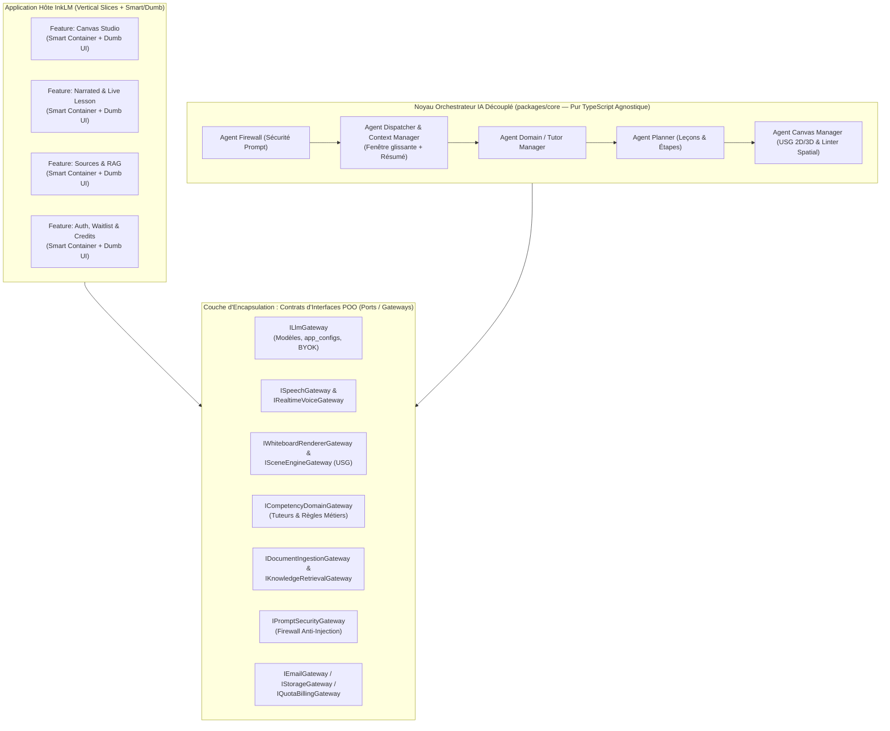

# 06 — Adéquation de l'Approche « Vertical Slicing + Smart/Dumb + Gateways » & Catalogue Exhaustif des Gateways (`inklm`)

Ce document analyse l'adéquation de la méthodologie architecturale **Vertical Slicing + Smart Containers / Dumb Components + Gateways (Ports & Adapters)** en la confrontant directement au code source réel du monorepo [`inklm/`](file:///c:/dev/_current_apps/whiteboard-ai-orchestrator/inklm/package.json), aux spécifications fonctionnelles ([`_dev/spec/`](file:///c:/dev/_current_apps/whiteboard-ai-orchestrator/_dev/spec/00_index_specs.md)), aux plans d'implémentation ([`_dev/implementation_plans/`](file:///c:/dev/_current_apps/whiteboard-ai-orchestrator/_dev/implementation_plans/00_index_architecture.md)) et aux orientations de conception ([`_notes_architecture_actuelle.md`](file:///c:/dev/_current_apps/whiteboard-ai-orchestrator/_dev/_notes_architecture_actuelle.md)).

---

## 1. Évaluation Critique : L'Approche « Vertical Slicing + Smart/Dumb + Gateways » est-elle adaptée à `inklm` ?

### 1.1 Verdict : **Oui, à 100 %, à condition d'appliquer une séparation à deux niveaux (Hôte vs. Noyau Orchestrateur)**

L'analyse croisée de votre discussion avec Gemini et du code actuel d'`inklm` montre que cette approche résout exactement les pathologies identifiées dans les plans `01` à `05` :

1. **Pourquoi le pattern *Smart Containers / Dumb Components* est vital pour `apps/web`** :
   - Aujourd'hui, [`apps/web/src/hooks/use-canvas-page-controller.ts`](file:///c:/dev/_current_apps/whiteboard-ai-orchestrator/inklm/apps/web/src/hooks/use-canvas-page-controller.ts) (**1 417 lignes**), [`apps/web/src/hooks/use-agent-session.ts`](file:///c:/dev/_current_apps/whiteboard-ai-orchestrator/inklm/apps/web/src/hooks/use-agent-session.ts) (**~650 lignes**) et [`apps/web/src/components/excalidraw/ExcalidrawWrapper.tsx`](file:///c:/dev/_current_apps/whiteboard-ai-orchestrator/inklm/apps/web/src/components/excalidraw/ExcalidrawWrapper.tsx) mélangent l'état UI, les appels réseau (`fetch`), la manipulation impérative d'Excalidraw (`updateScene`, `addFiles`, `exportToSvg`), l'inspection des noms d'outils IA (`drawDiagram`, `presentLessonStep`), IndexedDB et `localStorage`.
   - En séparant les **Smart Containers** (qui orchestrent les hooks, les stores et les Gateways clients) des **Dumb Components** (composants purement déclaratifs recevant des `props` et émettant des callbacks `on...`), l'interface utilisateur devient agnostique du moteur de rendu et de l'orchestrateur.

2. **Pourquoi le *Vertical Slicing* est indispensable dans `apps/web` et `apps/functions`** :
   - Actuellement, `apps/web/src` est organisé en couches techniques horizontales (`components/`, `hooks/`, `lib/`, `stores/`). Une seule fonctionnalité comme les **Leçons Narrées** est éclatée entre `hooks/use-lesson-player.ts`, `lib/lesson-player.ts`, `lib/lesson-slides.ts`, `lib/lesson-history.ts`, `lib/recording-cloud.ts`, `lib/recording-assets.ts` et `apps/functions/src/recordings.ts`.
   - Regrouper l'application hôte en **Tranches Verticales (`features/`)** réduit drastiquement le *blast radius* (rayon d'impact) lors du codage humain ou agentique.

3. **La Nuance Architecturale Cruciale par rapport à l'exemple générique de Gemini** :
   - Dans la discussion générique, l'exemple plaçait `core/AnimationOrchestrator.ts` *à l'intérieur* d'une tranche verticale frontend (`src/features/ai-animation/core/`).
   - **Dans le cas d'`inklm`, l'Orchestrateur (`@inklm/core`) ne doit PAS être enfermé dans une feature frontend de `apps/web`** : votre objectif (cf. [`00_index_architecture.md`](file:///c:/dev/_current_apps/whiteboard-ai-orchestrator/_dev/implementation_plans/00_index_architecture.md) et [`1-meeting-1&2-novembre-2026-pv-orchestrateur-pfe.md`](file:///c:/dev/_current_apps/whiteboard-ai-orchestrator/meetings/1-meeting-1&2-novembre-2026-pv-orchestrateur-pfe.md)) est d'extraire un **Orchestrateur IA 2D/3D agnostique et réutilisable** par différentes plateformes (InkLM, Socratix, etc.).
   - **La solution optimale** consiste donc à combiner :
     - **Macro-architecture de l'Application Hôte (`apps/web`, `apps/functions`)** : **Vertical Slicing + Smart/Dumb Components**.
     - **Architecture du Noyau (`packages/core` / futur `@whiteboard-ai/orchestrator`)** : **Architecture Hexagonale Pure (Ports & Adapters / Gateways orientés Interfaces POO)** + **Sous-Agents Spécialisés**.



---

## 2. Cartographie Exhaustive des 10 Gateways Nécessaires (Approche Interfaces POO / SOLID)

Votre intuition est exacte : limiter les Gateways à l'Email et à l'API LLM laisserait l'orchestrateur fortement couplé au TTS, à Gemini Live, à Excalidraw, aux 5 tuteurs codés en dur et au stockage R2/Supabase.

Voici les **10 Gateways (Interfaces POO)** nécessaires pour atteindre le découplage total (principe *Open/Closed* et *Dependency Inversion*), classés par priorité stratégique :

---

### Gateway 1 : `ILlmGateway` (Inférence LLM, Gouvernance `app_configs` & Télémetrie)
- **Référence notes** : [`_notes_architecture_actuelle.md#L12`](file:///c:/dev/_current_apps/whiteboard-ai-orchestrator/_dev/_notes_architecture_actuelle.md#L12), [`02_pipeline_llm_et_outils.md#L81-L89`](file:///c:/dev/_current_apps/whiteboard-ai-orchestrator/_dev/implementation_plans/02_pipeline_llm_et_outils.md#L81-L89).
- **Couplage actuel dans le code** :
  - [`packages/core/src/agent/orchestrator.ts`](file:///c:/dev/_current_apps/whiteboard-ai-orchestrator/inklm/packages/core/src/agent/orchestrator.ts#L184-L250) et [`providers.ts`](file:///c:/dev/_current_apps/whiteboard-ai-orchestrator/inklm/packages/core/src/agent/providers.ts) importent directement `@ai-sdk/google`, `@ai-sdk/openai`, codent en dur `https://api.meta.ai/v1`, les modèles (`CHAT_MODELS` dans [`models.ts`](file:///c:/dev/_current_apps/whiteboard-ai-orchestrator/inklm/packages/core/src/agent/models.ts)) et les options propriétaires (`thinkingConfig`).
  - [`packages/core/src/agent/titles.ts`](file:///c:/dev/_current_apps/whiteboard-ai-orchestrator/inklm/packages/core/src/agent/titles.ts) effectue ses propres appels HTTP pour nommer les tableaux.
- **Responsabilité de l'Interface (`ILlmGateway`)** :
  - Encapsuler toute génération textuelle/structurée (`streamChat`, `generateObject`, `embedText`, `validateApiKey`).
  - Lire dynamiquement les modèles actifs (activation `on/off`, priorités de fallback, coûts en crédits) depuis une table `app_configs` et récupérer les clés API depuis **Supabase Vault** (pour la plateforme) ou le coffre BYOK.
  - Centraliser le suivi d'usage (tokens entrants/sortants/cachés, latence, erreurs fournisseur).
- **Adaptateurs interchangeables** : `GoogleGeminiAdapter`, `MetaMuseAdapter`, `OpenRouterAdapter`, `DeepInfraAdapter`, `OpenAIAdapter`, `AnthropicAdapter`.

```typescript
export interface ILlmGateway {
  listAvailableModels(context?: { includeByokForUserId?: string }): Promise<ModelDescriptor[]>;
  streamCompletion(request: LlmStreamRequest): Promise<LlmStreamHandle>;
  generateStructured<T>(request: LlmStructuredRequest<T>): Promise<LlmStructuredResult<T>>;
  embedText(text: string, modelId?: string): Promise<number[]>;
  validateProviderKey(providerId: string, rawApiKey: string): Promise<KeyValidationResult>;
}
```

---

### Gateway 2 : `ISpeechGateway` & `IRealtimeVoiceGateway` (TTS & Audio Bidirectionnel Live)
- **Référence intuition utilisateur** : *« TTS: text to speech / communication bidirectionnelle avec les LLM »* + [`04_lecons_narrees_et_temps_reel.md`](file:///c:/dev/_current_apps/whiteboard-ai-orchestrator/_dev/spec/04_lecons_narrees_et_temps_reel.md).
- **Couplage actuel dans le code** :
  - **TTS** : [`packages/core/src/agent/speech.ts`](file:///c:/dev/_current_apps/whiteboard-ai-orchestrator/inklm/packages/core/src/agent/speech.ts#L98-L280) appelle en dur `https://openrouter.ai/api/v1/chat/completions` (`heygen-voice-1-turbo:free`) et `https://generativelanguage.googleapis.com/v1beta/interactions` (`gemini-3.8-flash-lite-tts`).
  - **Live Vocal Bidirectionnel** : [`apps/functions/src/index.ts`](file:///c:/dev/_current_apps/whiteboard-ai-orchestrator/inklm/apps/functions/src/index.ts#L586-L659) instancie `new GoogleGenAI` (`@google/genai`) pour émettre un jeton éphémère, et côté client [`apps/web/src/lib/live-teaching-session.ts`](file:///c:/dev/_current_apps/whiteboard-ai-orchestrator/inklm/apps/web/src/lib/live-teaching-session.ts) ouvre directement le WebSocket propriétaire Gemini Live.
- **Pourquoi deux interfaces distinctes mais complémentaires** :
  1. **`ISpeechGateway` (Synthèse Vocale Asynchrone / Par Étape)** : Convertit un script nettoyé + une tonalité (`warm`, `emphatic`, `calm`) en flux/buffer audio normalisé avec sa durée exacte.
  2. **`IRealtimeVoiceGateway` (Session Vocale Bidirectionnelle Full-Duplex)** : Abstrait l'ouverture de session temps réel (`mintSessionCredentials` côté serveur, et `IRealtimeVoiceClientSession` côté navigateur : `connect`, `sendAudioChunk`, `interrupt`, `onTranscript`, `onToolCall("start_visual_lesson")`, `onAudioOutput`).
- **Gain** : Permet de remplacer HeyGen/Gemini TTS par ElevenLabs, Cartesia ou OpenAI TTS, et de remplacer Gemini Live par OpenAI Realtime WebRTC, Moshi ou Ultravox sans toucher à `LessonPlayer` ni à `TeachingConductor`.

```typescript
export interface ISpeechGateway {
  synthesize(input: {
    text: string;
    tone?: SpeechTone;
    voiceId?: string;
    signal?: AbortSignal;
  }): Promise<{ audioBytes: Uint8Array; mimeType: string; durationMs: number; provider: string }>;
}

export interface IRealtimeVoiceGateway {
  createEphemeralSession(config: RealtimeSessionConfig): Promise<RealtimeSessionTicket>;
}
```

---

### Gateway 3 : `IWhiteboardRendererGateway` & `ISceneEngineGateway` (Gestion du Whiteboard 2D/3D)
- **Référence intuition utilisateur & notes** : *« la gestion des whiteboard »* + [`_notes_architecture_actuelle.md#L16`](file:///c:/dev/_current_apps/whiteboard-ai-orchestrator/_dev/_notes_architecture_actuelle.md#L16) (*« La gestion de canvas doit être faite exclusivement via un agent dédié "Canvas Manager" »*) + [`03_moteur_geometrique_et_templates.md`](file:///c:/dev/_current_apps/whiteboard-ai-orchestrator/_dev/implementation_plans/03_moteur_geometrique_et_templates.md) + [`04_canvas_renderer_et_animation.md`](file:///c:/dev/_current_apps/whiteboard-ai-orchestrator/_dev/implementation_plans/04_canvas_renderer_et_animation.md).
- **Couplage actuel dans le code** :
  - Côté Core : Les 26 templates ([`expand.ts`](file:///c:/dev/_current_apps/whiteboard-ai-orchestrator/inklm/packages/core/src/parser/domain/predefined/expand.ts)), le normaliseur ([`normalizer.ts`](file:///c:/dev/_current_apps/whiteboard-ai-orchestrator/inklm/packages/core/src/parser/normalizer.ts)), la réconciliation ([`scene.ts`](file:///c:/dev/_current_apps/whiteboard-ai-orchestrator/inklm/packages/core/src/adapters/scene.ts)) et l'export PPTX ([`pptx.ts`](file:///c:/dev/_current_apps/whiteboard-ai-orchestrator/inklm/packages/core/src/lesson/pptx.ts)) produisent et manipulent directement des attributs propres à Excalidraw (`roughness`, `fillStyle`, `seed`, `versionNonce`, `containerId`/`boundElements`, `BinaryFiles`).
  - Côté Frontend : [`ExcalidrawWrapper.tsx`](file:///c:/dev/_current_apps/whiteboard-ai-orchestrator/inklm/apps/web/src/components/excalidraw/ExcalidrawWrapper.tsx), [`svg-stage.ts`](file:///c:/dev/_current_apps/whiteboard-ai-orchestrator/inklm/apps/web/src/lib/stage/svg-stage.ts) et [`use-canvas-page-controller.ts`](file:///c:/dev/_current_apps/whiteboard-ai-orchestrator/inklm/apps/web/src/hooks/use-canvas-page-controller.ts) appellent directement `ExcalidrawImperativeAPI` et `exportToSvg`.
- **Architecture Cible à Deux Interfaces autour du *Universal Scene Graph (USG)*** :
  1. **Côté Serveur / Core (`ISceneAdapterGateway` utilisé par l'Agent `CanvasManager`)** : L'Agent `CanvasManager` travaille uniquement sur des nœuds sémantiques USG (`UsgNode`, `UsgEdge`, `UsgFormula`, `UsgTemplate`, `Usg3DObject`). Le Gateway `ISceneAdapterGateway` traduit le patch USG vers le format du moteur cible (ex. `ExcalidrawSceneAdapter`, `ThreeJs3DSceneAdapter`, `TldrawSceneAdapter`).
  2. **Côté Client (`IWhiteboardRendererGateway`)** : Interface unique exposée aux Smart Containers, au `DrawingDirector`, au `LessonPlayer` et au `TeachingConductor` pour piloter n'importe quel moteur 2D ou 3D.

```typescript
export interface IWhiteboardRendererGateway {
  getSceneSnapshot(): UniversalSceneSnapshot;
  getSelection(): UsgNode[];
  getViewportBounds(): BoundingBox2D;
  applyScenePatch(patch: UsgPatch, options?: { recordHistory?: boolean }): void;
  playStrokeReveal(stage: RevealStage, signal?: AbortSignal): Promise<void>;
  animateCameraTo(targetBounds: BoundingBox2D, options?: CameraAnimationOptions): Promise<void>;
  setPointerTarget(target: PointerTarget | null): void;
  setHighlightedElements(ids: string[], style?: HighlightStyle): void;
  exportToImage(format: "svg" | "png" | "webp", subsetIds?: string[]): Promise<Blob>;
  onSceneChange(listener: (snapshot: UniversalSceneSnapshot, source: "user" | "agent") => void): () => void;
}
```

---

### Gateway 4 : `ICompetencyDomainGateway` (Gestion des Domaines de Compétences & Profils de Tuteurs)
- **Référence intuition utilisateur & notes** : *« la gestion des domaines de compétences »* + [`_notes_architecture_actuelle.md#L6-L9`](file:///c:/dev/_current_apps/whiteboard-ai-orchestrator/_dev/_notes_architecture_actuelle.md#L6-L9).
- **Couplage actuel dans le code** :
  - Les 5 profils de tuteurs (`general`, `it`, `math`, `physics`, `medical`) sont codés en dur dans [`packages/core/src/agent/tutors.ts`](file:///c:/dev/_current_apps/whiteboard-ai-orchestrator/inklm/packages/core/src/agent/tutors.ts#L17-L59) avec des directives Excalidraw figées dans le code source.
  - Il est impossible pour une application cliente (InkLM ou une plateforme tierce) de créer dynamiquement un nouveau domaine de compétence (ex. *Chimie Organique*, *Droit*, *Architecture Cloud AWS*, *Économie*) sans modifier et recompiler `@inklm/core`.
- **Responsabilité de l'Interface (`ICompetencyDomainGateway`)** :
  - Permettre à la plateforme externe d'**enregistrer / mettre à jour / stocker en base** des profils de domaines de compétences (`CompetencyDomainProfile` : instructions pédagogiques, templates visuels autorisés, outils spécialisés, garde-fous métier).
  - Fournir un mécanisme de **routage hybride** (via un *Agent Tutor/Domain Manager*) :
    - Si la plateforme hôte fixe le domaine (`domainId` explicite), charger ce profil.
    - Si le mode est automatique (`auto`), classifier l'intention de la requête utilisateur pour sélectionner ou combiner les domaines de compétences pertinents.

```typescript
export interface CompetencyDomainProfile {
  id: string; // ex: "it", "math", "chemistry", "custom:aws-arch"
  name: string;
  description: string;
  pedagogicalRulesPrompt: string;
  preferredVisualTemplates: string[];
  allowedToolIds?: string[];
  safetyConstraints?: string[];
}

export interface ICompetencyDomainGateway {
  getDomain(domainId: string): Promise<CompetencyDomainProfile | null>;
  listDomains(tenantOrAppId?: string): Promise<CompetencyDomainProfile[]>;
  upsertDomain(profile: CompetencyDomainProfile): Promise<CompetencyDomainProfile>;
  classifyUserIntentToDomain(userPrompt: string, availableDomains: CompetencyDomainProfile[]): Promise<string>;
}
```

---

### Gateway 5 : `IDocumentIngestionGateway` & `IKnowledgeRetrievalGateway` (Ingestion Documentaire, RAG Externe & Web Search)
- **Référence intuition utilisateur & notes** : *« l'ingestion de documents »* + [`_notes_architecture_actuelle.md#L1`](file:///c:/dev/_current_apps/whiteboard-ai-orchestrator/_dev/_notes_architecture_actuelle.md#L1) (*« tenir compte que la documentation peut être fournie depuis l'extérieur (RAG / ou comme on a fait dans socratix). donc, on doit être capable de contrôler les sources d'information disponibles à l'orchestrateur (documentation fixée / recherche web) »*).
- **Couplage actuel dans le code** :
  - L'ingestion PDF ([`packages/core/src/research/ingest.ts`](file:///c:/dev/_current_apps/whiteboard-ai-orchestrator/inklm/packages/core/src/research/ingest.ts), [`pdf.ts`](file:///c:/dev/_current_apps/whiteboard-ai-orchestrator/inklm/packages/core/src/research/pdf.ts)) est directement câblée dans [`apps/functions/src/index.ts`](file:///c:/dev/_current_apps/whiteboard-ai-orchestrator/inklm/apps/functions/src/index.ts#L791-L824) sur le bucket R2 (`research/${userId}/${id}.json`).
  - La recherche documentaire ([`packages/core/src/research/search.ts`](file:///c:/dev/_current_apps/whiteboard-ai-orchestrator/inklm/packages/core/src/research/search.ts)) ne supporte que le scoring lexical en mémoire sur les JSON R2, sans pouvoir interroger un moteur RAG vectoriel externe (comme dans Socratix).
  - La recherche web ([`packages/core/src/agent/sources.ts`](file:///c:/dev/_current_apps/whiteboard-ai-orchestrator/inklm/packages/core/src/agent/sources.ts#L172-L184)) est couplée à `google.tools.googleSearch({})`.
- **Responsabilité des Deux Interfaces** :
  1. **`IDocumentIngestionGateway`** : Ingérer de manière sécurisée (via un `ISafeFetchGateway` anti-SSRF) des PDF, fichiers DOCX/PPTX, articles arXiv ou pages web, et en extraire les sections, passages et figures.
  2. **`IKnowledgeRetrievalGateway`** : Offrir à l'orchestrateur une interface unique de recherche et de lecture de passages avec une **politique de contrôle des sources (`KnowledgePolicy`)** définie par l'application appelante :
     - Mode `STRICT_INTERNAL_RAG` : L'orchestrateur n'a accès qu'à la base documentaire fixée (ex. cours du professeur dans Socratix ou documents du projet), recherche web désactivée.
     - Mode `HYBRID_RAG_AND_WEB` : Priorité aux documents ingérés/RAG, avec fallback autorisé vers la recherche web vérifiée.
     - Mode `WEB_GROUNDING_ONLY` : Recherche web avec citations vérifiées.

```typescript
export interface KnowledgePolicy {
  allowInternalRag: boolean;
  allowSessionDocuments: boolean;
  allowWebSearch: boolean;
  strictGroundingOnly?: boolean; // Interdit d'extrapoler hors des documents fournis
}

export interface IKnowledgeRetrievalGateway {
  listAvailableSources(scope: KnowledgeScope): Promise<KnowledgeSourceSummary[]>;
  searchPassages(query: string, scope: KnowledgeScope, policy: KnowledgePolicy): Promise<KnowledgePassageHit[]>;
  readPassageWindow(sourceId: string, passageIndex: number, windowSize?: number): Promise<KnowledgePassage[]>;
  searchVerifiedWeb(query: string, depth?: "fast" | "deep"): Promise<{ summary: string; citations: CitationSource[] }>;
}
```

---

### Gateway 6 : `IPromptSecurityGateway` (Agent Pare-Feu Anti-Prompt Injection & Gouvernance d'Intention)
- **Référence notes & audit sécurité** : [`_notes_architecture_actuelle.md#L10`](file:///c:/dev/_current_apps/whiteboard-ai-orchestrator/_dev/_notes_architecture_actuelle.md#L10) (*« Il faut avoir un agent servant comme pare-feu contre le prompt injection qui sera utilisé pour se protéger nativement contre toutes ces attaques en analysant tous les inputs (prompts) avant de les traiter »*) + constat `SEC-03` de l'audit.
- **Couplage actuel dans le code** :
  - [`packages/core/src/agent/policy.ts`](file:///c:/dev/_current_apps/whiteboard-ai-orchestrator/inklm/packages/core/src/agent/policy.ts#L3-L47) utilise de simples expressions régulières sur le texte concaténé du message (y compris le contenu web injecté par `expandLinkSources`), ce qui permet à une page web externe de déverrouiller `allowDelete` / `allowClear`.
- **Responsabilité de l'Interface (`IPromptSecurityGateway`)** :
  - Analyser chaque prompt utilisateur **avant** son entrée dans l'orchestrateur (détection de jailbreak, d'exfiltration de prompt système, d'injection d'instructions contradictoires).
  - Isoler et analyser séparément les contenus externes (pages web scrapées, PDF ingérés) via un marquage de frontière de confiance (*Untrusted Data Boundary*).
  - Émettre un objet de permissions immuable (`TurnSecurityClearance`) déterminant si l'utilisateur a réellement demandé une action destructive (`allowDeleteElements`, `allowClearBoard`).

```typescript
export interface TurnSecurityClearance {
  verdict: "allow" | "sanitize" | "block";
  sanitizedUserPrompt: string;
  riskScore: number;
  detectedThreats: string[];
  permissions: {
    allowDeleteElements: boolean;
    allowClearBoard: boolean;
    allowEditExisting: boolean;
  };
}

export interface IPromptSecurityGateway {
  inspectUserPrompt(rawPrompt: string, context?: { userId?: string }): Promise<TurnSecurityClearance>;
  sanitizeExternalContent(untrustedText: string, sourceUri: string): Promise<string>;
}
```

---

### Gateway 7 : `IConversationMemoryGateway` (Gestion du Contexte à Fenêtre Glissante & Résumé Hiérarchique)
- **Référence notes** : [`_notes_architecture_actuelle.md#L3-L4`](file:///c:/dev/_current_apps/whiteboard-ai-orchestrator/_dev/_notes_architecture_actuelle.md#L3-L4) (*« fenêtre glissante des X derniers messages inclus intégralement et on résume les messages qui dépassent X »*).
- **Couplage actuel dans le code** :
  - [`packages/core/src/agent/history.ts`](file:///c:/dev/_current_apps/whiteboard-ai-orchestrator/inklm/packages/core/src/agent/history.ts) et [`context.ts`](file:///c:/dev/_current_apps/whiteboard-ai-orchestrator/inklm/packages/core/src/agent/context.ts) tronquent de manière statique à 12 messages (`RECENT_MESSAGE_WINDOW = 12`) avec une concaténation textuelle simpliste (`MAX_SUMMARY_CHARS = 3200`) qui perd les détails techniques des tours précédents, tandis que la persistance des messages est gérée séparément dans [`crud.ts`](file:///c:/dev/_current_apps/whiteboard-ai-orchestrator/inklm/apps/functions/src/crud.ts) et [`packages/db/src/index.ts`](file:///c:/dev/_current_apps/whiteboard-ai-orchestrator/inklm/packages/db/src/index.ts).
- **Responsabilité de l'Interface (`IConversationMemoryGateway`)** :
  - Implémenter la politique exacte de **Fenêtre Glissante Configurable ($X$ derniers messages intégraux)** + **Résumé Sémantique Incrémental** mis en cache des messages plus anciens que $X$.
  - Découpler l'orchestrateur du format `UIMessage` du Vercel AI SDK et de la table PostgreSQL `chat_messages`.

---

### Gateway 8 : `IVisualAssetGateway` (Bibliothèque de Symboles Vectoriels & Médias Éducatifs)
- **Référence spécifications** : [`06_recherche_sources_et_assets.md#L30-L38`](file:///c:/dev/_current_apps/whiteboard-ai-orchestrator/_dev/spec/06_recherche_sources_et_assets.md#L30-L38).
- **Couplage actuel dans le code** :
  - [`packages/core/src/agent/tools.ts`](file:///c:/dev/_current_apps/whiteboard-ai-orchestrator/inklm/packages/core/src/agent/tools.ts#L469-L671) et [`images.ts`](file:///c:/dev/_current_apps/whiteboard-ai-orchestrator/inklm/packages/core/src/agent/images.ts) interrogent directement Wikimedia Commons et la table Supabase `library_items` (avec des éléments déjà au format Excalidraw).
- **Responsabilité de l'Interface (`IVisualAssetGateway`)** :
  - Fournir `searchVectorComponents(query, domain)` (retournant des symboles au format USG) et `searchEducationalImages(query)` (Wikimedia Commons, banques d'images scientifiques, figures extraites des PDF de l'élève).

---

### Gateway 9 : `IEmailNotificationGateway` (Envoi Transactionnel d'Emails, Tracking & Re-jeu)
- **Référence intuition utilisateur & notes** : [`_notes_architecture_actuelle.md#L14`](file:///c:/dev/_current_apps/whiteboard-ai-orchestrator/_dev/_notes_architecture_actuelle.md#L14) (*« l'envoi d'emails se fait via une gateway API centralisée pour faciliter le tracking d'usage et le re-envoi d'emails en cas de pannes »*).
- **Couplage actuel dans le code** :
  - Les Edge Functions Supabase ([`send-auth-email`](file:///c:/dev/_current_apps/whiteboard-ai-orchestrator/inklm/supabase/functions/send-auth-email/index.ts), [`waitlist-joined`](file:///c:/dev/_current_apps/whiteboard-ai-orchestrator/inklm/supabase/functions/waitlist-joined/index.ts), [`approve-waitlisted-user`](file:///c:/dev/_current_apps/whiteboard-ai-orchestrator/inklm/supabase/functions/approve-waitlisted-user/index.ts)) appellent directement l'API Resend (`_shared/resend.ts`) via des triggers SQL `pg_net` sans table de suivi (`email_outbox`) ni mécanisme de retry en cas d'indisponibilité de Resend.
- **Responsabilité de l'Interface (`IEmailNotificationGateway`)** :
  - Encapsuler l'envoi d'e-mails transactionnels (`sendTransactionalEmail`), enregistrer chaque tentative dans une table d'outbox (`status: "queued" | "sent" | "failed"`, `retry_count`, `provider_message_id`, `last_error`), et permettre le basculement transparent entre Resend, AWS SES, Postmark ou SMTP avec re-envoi automatique des échecs.

---

### Gateway 10 : `IObjectStorageGateway` & `IQuotaBillingGateway` (Stockage Binaire Unifié & Comptabilité Atomique des Crédits)
- **Référence plans & audit** : [`01_api_workers_et_contrats.md`](file:///c:/dev/_current_apps/whiteboard-ai-orchestrator/_dev/implementation_plans/01_api_workers_et_contrats.md), constats `SEC-01`, `SEC-04`, `PERF-04`.
- **Couplage actuel dans le code** :
  - `apps/functions/src/index.ts` mélange le binding Cloudflare R2 (`c.env.ASSETS`) et `@aws-sdk/client-s3`, tandis que la vérification/consommation des crédits (`requireCredits`, `spendCredits`) est codée manuellement par route dans `index.ts` (avec des oublis critiques sur `live-token`, `plan-lesson` et `speech`).
- **Responsabilité des Interfaces** :
  - `IObjectStorageGateway` : Unifier `put`, `get`, `head`, `delete`, `signUploadUrl`, `signDownloadUrl` + validation MIME/taille réelle (`assertUploadPolicy`), compatible Cloudflare R2, S3, Supabase Storage ou système de fichiers local.
  - `IQuotaBillingGateway` : Gérer atomiquement le cycle `reserveCredits(userId, operation)` $\to$ exécution du Gateway IA/TTS/Live $\to$ `commitCredits(reservationId, actualUsage)` ou `rollbackReservation(reservationId)`.

---

## 3. Architecture Cible Unifiée : Comment Combiner les 3 Concepts dans le Monorepo `inklm`

Voici comment l'arborescence du monorepo se transforme pour marier **Vertical Slicing** (dans les applications), **Smart/Dumb Components** (dans le frontend) et **Gateways + Agents Spécialisés** (dans les packages partagés et le noyau) :

```text
inklm/
├── packages/
│   ├── gateways/                        # NOUVEAU : Contrats d'Interfaces POO (Ports) & Adaptateurs d'Infrastructure
│   │   └── src/
│   │       ├── contracts/               # Interfaces pures (ILlmGateway, ISpeechGateway, IRealtimeVoiceGateway,
│   │       │                            # IWhiteboardRendererGateway, ICompetencyDomainGateway,
│   │       │                            # IDocumentIngestionGateway, IKnowledgeRetrievalGateway,
│   │       │                            # IPromptSecurityGateway, IEmailNotificationGateway, IObjectStorageGateway)
│   │       └── adapters/                # Implémentations concrètes interchangeables :
│   │           ├── llm/                 # GoogleGeminiAdapter, MetaMuseAdapter, OpenRouterAdapter, AppConfigRegistry
│   │           ├── speech/              # HeyGenSpeechAdapter, GeminiTtsAdapter, GeminiLiveVoiceAdapter
│   │           ├── knowledge/           # R2DocumentAdapter, SupabasePgVectorRagAdapter, GoogleWebSearchAdapter
│   │           ├── email/               # ResendEmailAdapter (avec Outbox & Retry)
│   │           └── storage/             # CloudflareR2Adapter, S3PresignerAdapter, LocalFsAdapter
│   │
│   └── core/                            # NOYAU ORCHESTRATEUR PUR (Zéro dépendance à Supabase, R2, Resend ou Excalidraw DOM)
│       └── src/
│           ├── agents/                  # Sous-Agents Spécialisés :
│           │   ├── firewall-agent.ts    # Protection native contre le Prompt Injection (via IPromptSecurityGateway)
│           │   ├── dispatcher-agent.ts  # Routage d'intention & assemblage du contexte (Fenêtre glissante X + résumé)
│           │   ├── tutor-manager.ts     # Gestion dynamique des domaines de compétences (via ICompetencyDomainGateway)
│           │   ├── lesson-planner.ts    # Planification multi-étapes (beats) et orchestration temporelle
│           │   └── canvas-manager.ts    # Agent exclusif de génération/édition de scène USG + Linter Spatial
│           ├── usg/                     # Universal Scene Graph (Représentation intermédiaire 2D/3D agnostique)
│           ├── geometry/                # Templates métiers, Dagre, Routage A*, LayoutCheck (opérant sur l'USG)
│           └── renderers/               # Adaptateurs de sérialisation USG <-> Excalidraw / SVG / PPTX / 3D
│
└── apps/
    ├── web/                             # FRONTEND NEXT.JS : Découpé en VERTICAL SLICES + SMART/DUMB
    │   └── src/
    │       ├── features/
    │       │   ├── canvas-studio/       # Tranche 1 : Tableau blanc, barre d'outils, caméra, undo par tour
    │       │   │   ├── components/      # Dumb Components (CanvasToolbar, ZoomControls, UndoBanner — props pures)
    │       │   │   ├── containers/      # Smart Containers (CanvasWorkspaceContainer — connecte IWhiteboardRendererGateway)
    │       │   │   └── adapters/        # ExcalidrawRendererGateway, SvgStageOverlayAdapter
    │       │   ├── ai-tutor-chat/       # Tranche 2 : Chat multimodal, sélecteur de tuteur/modèle, streaming
    │       │   │   ├── components/      # Dumb Components (MessageList, PromptComposer, TutorBadge, CitationPill)
    │       │   │   └── containers/      # Smart Containers (ChatSidebarContainer)
    │       │   ├── narrated-lesson/     # Tranche 3 : Lecteur de leçons TTS, timeline, export PPTX, recordings
    │       │   │   ├── components/      # Dumb Components (LessonTimelineBar, PlaybackControls, TeacherCursorView)
    │       │   │   └── containers/      # Smart Containers (LessonPlayerContainer)
    │       │   ├── live-voice-session/  # Tranche 4 : Session vocale temps réel bidirectionnelle
    │       │   │   ├── components/      # Dumb Components (VoiceWaveform, MicStatusButton, LiveCaptionOverlay)
    │       │   │   └── containers/      # Smart Containers (RealtimeTeachingContainer — utilise IRealtimeVoiceGateway)
    │       │   ├── knowledge-sources/   # Tranche 5 : Upload PDF/arXiv/liens, panneau des sources
    │       │   │   ├── components/      # Dumb Components (SourcesList, PdfDropzone, SourcePreviewCard)
    │       │   │   └── containers/      # Smart Containers (SourcesPanelContainer)
    │       │   ├── projects-dashboard/  # Tranche 6 : Grille de projets, recherche, synchronisation offline/online
    │       │   └── access-and-billing/  # Tranche 7 : Auth, Waitlist, Quotas de crédits, clés BYOK
    │       └── shared/                  # Design System UI pur (components/ui/*)
    │
    └── functions/                       # BACKEND WORKER : Tranches verticales d'endpoints Hono branchant les Gateways
```

---

## 4. Ordre de Bataille Recommandé (Séquencement sans Régression)

Conformément à votre feuille de route ([`__toDo_mohamed.md`](file:///c:/dev/_current_apps/whiteboard-ai-orchestrator/_dev/__toDo_mohamed.md)), l'ordre optimal pour exécuter cette transformation sans jamais casser l'application est le suivant :

1. **Étape 1 — Correctifs Critiques de Sécurité & Intégrité (Batch 1 de l'Audit)** :
   - Appliquer les correctifs immédiats (`SEC-01` à `SEC-07`, `PERF-01`, `CONS-01`, `CONS-02`) afin d'assainir la base actuelle.
2. **Étape 2 — Extraction des Gateways d'Infrastructure & Domaine (`packages/gateways`)** :
   - Créer les interfaces POO (`ILlmGateway`, `ISpeechGateway`, `IRealtimeVoiceGateway`, `ICompetencyDomainGateway`, `IDocumentIngestionGateway`, `IKnowledgeRetrievalGateway`, `IPromptSecurityGateway`, `IEmailNotificationGateway`, `IObjectStorageGateway`, `IQuotaBillingGateway`) et encapsuler le code existant dans leurs adaptateurs par défaut.
   - *Résultat* : L'application fonctionne exactement comme avant, mais tous les appels externes passent désormais par des contrats d'interfaces stricts.
3. **Étape 3 — Refactoring Frontend en *Dumb Components / Smart Containers* + *Vertical Slicing* (`apps/web/src/features/`)** :
   - Décomposer les monolithes `use-canvas-page-controller.ts` (1 417 lignes) et `use-agent-session.ts` (650 lignes) en Smart Containers par tranche verticale, et extraire `IWhiteboardRendererGateway` autour d'Excalidraw.
4. **Étape 4 — Découplage Chirurgical du Noyau Orchestrateur (`packages/core`)** :
   - Maintenant que le réseau (Gateways) et l'UI (Smart/Dumb + `IWhiteboardRendererGateway`) sont isolés, restructurer `packages/core` autour des sous-agents dédiés (*Firewall Agent*, *Dispatcher & Sliding-Window Context*, *Tutor/Domain Manager*, *Lesson Planner*, *Canvas Manager* + *Universal Scene Graph*).

